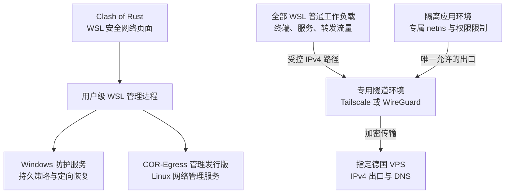

# Clash of Rust / Clash of WSL 用户原始需求汇编

> 生成日期：2026-10-24
> 范围：2026-10-14 至 2026-10-24（末条为 10-24 02:28）之间，Claude Code 与 Codex 中与本项目相关的用户输入。
> 本文件只收录**用户本人输入的原文**，不包含助手回复、工具输出、子代理提示词或系统注入内容。

## 1. 整理口径

| 项目 | 说明 |
| --- | --- |
| Claude Code 来源 | `C:\Users\xuan\.claude\projects\E--Desktop-workspace-Project-Clash-of-Rust\` 下的会话 JSONL，共 4 个；其中 `b2c629d4` 是本次“整理需求”的会话，未计入。 |
| Codex 来源 | `C:\Users\xuan\.codex\sessions\` 与 `archived_sessions\` 下的 rollout JSONL / JSONL.ZST（2026-09 至 2026-10）。 |
| 纳入规则 | ① 工作目录为 `E:\Desktop\workspace\Project\Clash-of-Rust` 的用户会话；② 工作目录在其他位置、但用户输入明确以 Clash of Rust / Clash of WSL 为主题的关联会话（表中标注“关联会话”）。 |
| 排除规则 | 子代理会话（`thread_source=subagent`，其“用户消息”是父代理下发的提示词）、自动审查会话（`guardian_review`）、纯 XUAN_VPS 服务器运维会话、无关的 Orca/Cloudflare 会话。 |
| 去重规则 | 连续重复的同一句话只保留一条；`[Request interrupted by user]`、`<subagent_notification>`、`<codex_internal_context>`、`<turn_aborted>`、应用生成的 PR 修复指令等非用户文本已剔除。 |
| 时间 | 统一换算为 UTC+8（本机时间）。 |
| 脱敏 | 公网服务器地址替换为 `<VPS-IPv4-已脱敏>` / `<VPS-IPv6-已脱敏>`；明文密码替换为 `<已脱敏>`。其余私有网段、路径、域名保持原样。 |
| 忠实度 | 正文按原文保留（包括错别字、重复、口语）。超长输入用代码块展示；个别条目是用户粘贴的终端输出/日志，同样原样保留。 |

## 2. 会话总览

| # | 首次输入（UTC+8） | 类别 | 来源 | 会话 ID | 主题 | 工作目录 | 收录条数 |
| --- | --- | --- | --- | --- | --- | --- | --- |
| 1 | 2026-10-14 19:18 | 关联 | Codex | `01a139ae` | 排查 XUAN_VPS 日志 → 改用 Clash of Rust 并验证出口/DNS | `E:\Desktop\workspace\Project\XUAN_VPS` | 27 |
| 2 | 2026-10-15 07:59 | 主项目 | Codex | `01a13cda` | 修复 Clash of Rust 本地页面打不开 | `E:\Desktop\workspace\Project\Clash-of-Rust` | 18 |
| 3 | 2026-10-15 10:04 | 关联 | Codex | `01a13d4b` | 配置 WSL 全流量经 Clash of Rust 到 VPS | `E:\Desktop\workspace\Project\XUAN_VPS` | 5 |
| 4 | 2026-10-15 22:47 | 主项目 | Codex | `01a14008` | 读取 Clash of Rust Issue 并构建 clash-wsl | `E:\Desktop\workspace\Project\Clash-of-Rust` | 7 |
| 5 | 2026-10-17 06:21 | 关联 | Codex | `01a146ce` | 同步 Clash of Rust 上游 Fork | `E:\Desktop\workspace\Project\XUAN_VPS` | 1 |
| 6 | 2026-10-17 06:22 | 主项目 | Codex | `01a146cf` | 同步上游 Fork；手机 ADB 订阅与 TUN | `E:\Desktop\workspace\Project\Clash-of-Rust` | 12 |
| 7 | 2026-10-17 06:55 | 主项目 | Codex | `01a146ed` | 规划 WSL Secure Egress 安全架构（主会话） | `E:\Desktop\workspace\Project\Clash-of-Rust` | 48 |
| 8 | 2026-10-18 17:16 | 主项目 | Codex | `01a14e4c` | 审查 fork 的 Pull Request | `E:\Desktop\workspace\Project\Clash-of-Rust` | 3 |
| 9 | 2026-10-21 06:38 | 主项目 | Codex | `01a15b77` | 排查定时弹出的蓝色终端 | `E:\Desktop\workspace\Project\Clash-of-Rust` | 2 |
| 10 | 2026-10-22 11:55 | 主项目 | Codex | `01a161c0` | Clash of WSL 现有漏洞与直连技术栈 | `E:\Desktop\workspace\Project\Clash-of-Rust` | 3 |
| 11 | 2026-10-22 14:32 | 主项目 | Codex | `01a1624e` | 审核 WSL Secure Egress 实施计划 | `E:\Desktop\workspace\Project\Clash-of-Rust` | 2 |
| 12 | 2026-10-22 14:34 | 主项目 | Codex | `01a16251` | 统计 Clash of Rust 运行后的本机 IPv4 出口 | `E:\Desktop\workspace\Project\Clash-of-Rust` | 1 |
| 13 | 2026-10-22 15:01 | 主项目 | Claude Code | `99cd322d` | Clash of WSL 审核、Ubuntu 26 联网、WSL Egress 工具化与收尾 | `E:\Desktop\workspace\Project\Clash-of-Rust` | 61 |
| 14 | 2026-10-22 17:33 | 主项目 | Codex | `01a162f4` | 审查 Clash of WSL 网络通信 | `E:\Desktop\workspace\Project\Clash-of-Rust` | 4 |
| 15 | 2026-10-23 02:05 | 主项目 | Claude Code | `7e2f16e3` | 代码审查与整体工具设计方案 | `E:\Desktop\workspace\Project\Clash-of-Rust` | 3 |
| 16 | 2026-10-23 22:07 | 主项目 | Claude Code | `a867043e` | 手机 USB 共享 / ADB / Clash of Rust App 测试 | `E:\Desktop\workspace\Project\Clash-of-Rust` | 37 |

## 3. 需求主题索引

以下索引按主题汇总需求出现的位置，正文仍按会话与时间排列。

### A. 客户端安装、本地页面与内核
- 10-15：本地 `127.0.0.1` 页面打不开、502，换 Edge 仍失败；要求立刻解决并保留完整功能。
- 10-14 / 10-15：要求卸载旧版、清理多余安装、只用官方 EXE 重装；排查“内核未启动”和“装了两份”。
- 10-15：用户告知 Clash of Rust 当天更新，要求更新并给出一份新会话提示词。

### B. Chrome / Claude / GPT 的出口与 DNS
- 10-15：Chrome 全部流量必须走 VPS，DNS 不得走国内解析；用 `ip.net.coffee` 核对；要求任何 Wi-Fi、开关 Clash 的情况下都不泄露本机 IP。
- 10-15：GPT 检测显示中国 IPv6；要求 OpenAI 与 Claude 相关域名优先走 VPS IPv4；整理两份 `site.html` 的域名清单；确认本机 Claude CLI / Desktop 是否受 Clash 管理。
- 访问 Claude/Anthropic 前必须先确认同一实际通路出口为德国；中国大陆或无法确认时禁止访问。

### C. WSL 全流量经 Clash of Rust 到 VPS
- 10-15：WSL 全部流量走 Clash of Rust，复刻 VPS 地区的时区/语言/地理位置指纹。
- 10-15：读取上游 issue，改写 Clash of Rust 并在项目中构建 `clash-wsl`，实现 WSL 流量直连 VPS、完全不暴露本机 IP。
- 10-17：确定 NAT + Hyper-V Firewall + Linux netns + Tailscale Exit Node + 德国 VPS 的架构；要求 WSL 内应用只能拿到局域网 IP 或 VPS 出口 IP。
- 10-17/18：把 `.wslconfig` 从 mirrored 改为 NAT；清理 WSL 内旧 mihomo 配置；要求 `clash of wsl` 接管 WSL 并与 Windows 侧通信、启动、展示状态；要求自动申请提权、自动安装配置与错误反馈。
- 10-22：审核“WSL Secure Egress 实施计划”；追问现有漏洞、直连技术栈、本机 IPv4 出口占比；要求对 WSL 网络通信做代码审查。

### D. 工具化与打包
- 10-22：整体审查后，把 WSL 与 VPS 上的工作打包为完整工具，分客户端与服务端；包含自检、初始化配置、配对、建隧道、建防火墙、自动识别 WSL 发行版、自动配置 WSL/Windows。
- 10-23：先出详细设计文档，暂不改代码。
- 10-23：整理项目文档、创建脚本、测试文件；整理所有 Git 分支并合并到 main；删除远端分支。

### E. Ubuntu 26 / WSL 运行环境
- 10-22 / 10-23：合并 wsl 分支；完成 Ubuntu 26 联网并安装配置应用；重启 WSL 后网络要能自动恢复。
- 10-23：只用 Ubuntu 26，两个发行版共用一个网络命名空间可以接受；优先解决 Ubuntu 26 的联网部署问题，WSL 内不要求访问 `ipgw`。
- 10-24：Ubuntu 22 占用 33 GB，要求清理。

### F. 手机端
- 10-21：用 ADB 给手机上的 Clash of Rust 配置订阅并连接 VPS；排查 IPv6/订阅/TUN 问题；提交 issue。
- 10-23：USB 网络共享；手机流量全部走 VPS；安装上游 Clash of Rust App、Google 服务、虚拟定位；检查时区/SIM/地理位置/IP 泄露；Play Integrity；Claude App 全部走 VPS；排查开启 Clash 后断网、TUN 只能上传不能下载。

### G. 系统清理、安装目录与 TUN 故障
- 10-21：排查蓝色终端定时弹出与计划任务来源。
- 10-24：确认 `D:\Clash\` 为最终安装/部署根目录，并写入 AGENT 文档。
- 10-24：把随意安装的 Clash of Rust / Clash of WSL（Windows 部分）工具与脚本迁移到 `D:/Clash`；重新编译、配置、测试。
- 10-24：TUN 开启后断网/回环；怀疑旧脚本改了 Windows 网络设置；要求只读审查系统网络、防火墙、Tailscale、WSL 配置，并记录所有网络操作。

### H. 文档与过程记录
- 10-23：整理项目文档、脚本与测试，合并分支，删除远端分支。
- 10-24：把做过的所有网络操作、脚本、分析结论写进项目文档；分析会话历史；形成完整过程文档。
- 10-23 / 10-24：每次修改前用 Git 保存状态并做文档记录；文档要能说明改了什么、影响、验证与回退。

## 4. 原始输入正文

### 4.1 排查 XUAN_VPS 日志 → 改用 Clash of Rust 并验证出口/DNS

- 来源：Codex　会话：`01a139ae-b893-7b11-95bf-7ec2c0e06958`　工作目录：`E:\Desktop\workspace\Project\XUAN_VPS`
- 时间跨度：2026-10-14 19:18 — 2026-10-15 07:50　收录：27 条
- 说明：关联会话（工作目录为 XUAN_VPS）。前 6 条属于 XUAN_VPS 自身，未收录；本段从“拉取 Clash of Rust”开始。

**[1] 2026-10-14 19:18**

> 你需要拉取https://github.com/Fu021/Clash-of-Rust项目到Project下，并且完成该工具的安装，此后将使用该工具去连接德国的VPS，你需要完成配置内容，注意不要修改代码，直接安装仓库中的已编译安装包；你需要完成应用的配置，相关的profile等等

**[2] 2026-10-14 20:14**

> 完成安装后，对常用的国内国外网站进行测试，对claude、gpt、gemini、google进行测试，利用https://ip.net.coffee/ 完成ip、dns、出口ip等检测；

**[3] 2026-10-14 20:55**

> 为什么clash of rust显示内核未启动？你确定可以正常访问吗？

**[4] 2026-10-14 21:00**

> 为什么clash of rust显示内核未启动？你为什么没有修复这个问题？

**[5] 2026-10-14 21:21**

> 你把这些都清理干净，使用exe安装clash of rust；再去完成项目的配置；

**[6] 2026-10-14 21:21**

> 你把这些都清理干净，使用exe安装clash of rust；再去完成项目的配置；并且注意不得访问claude

**[7] 2026-10-14 21:40**

> 为什么你会安装两个？

**[8] 2026-10-14 23:28**

> 继续

**[9] 2026-10-14 23:54**

> 你需要先告诉我一件事情，你只需要安装好应用，然后配置好文件即可，为什么你要做这么久？你的想法是什么？这个任务不是没有什么难度的吗？你在做什么？

**[10] 2026-10-14 23:56**

> 你需要确定XUAN VPS这套系统没有在使用了，网络走的都是Clash of rust

**[11] 2026-10-15 00:07**

> 我需要你检查我的网络的DNS是否会在连接google时暴露本地ip

**[12] 2026-10-15 00:16**

> 检查如何解决这个问题，我要求chrome应用的所有流量都必须走VPS，并且chrome的数据不得走国内的DNS，必须走外部的DNS进行解析；

**[13] 2026-10-15 00:50**

> 我现在正在进行测试，你不需要使用https://ip.net.coffee/claude/进行测试了

**[14] 2026-10-15 01:03**

> 我需要你根据https://ip.net.coffee/claude/site.html，根据其中的内容，去核对chrome中的是否会出现这里所涉及的问题，必须要避免让claude在任何时候，任何wifi网络下，是否开启和关闭clash时，都不会泄露出本机的ip等重要信息；

**[15] 2026-10-15 01:06**

> 我需要你根据https://ip.net.coffee/claude/site.html，根据其中的内容，去核对chrome中的是否会出现这里所涉及的问题，必须要避免让claude在任何时候，任何wifi网络下，是否开启和关闭clash时，都不会泄露出本机的ip等重要信息；我已经结束了测试，你可以关闭和重启chrome

**[16] 2026-10-15 01:38**

> 你做了什么修改？导致现在的网络无法正常访问了

**[17] 2026-10-15 03:18**

> 你做了什么修改？导致现在的网络无法正常访问了，我进行了手动恢复，详细的脚本在scripts下，以及在doc下的文档12，你需要阅读，并且要求在项目的agent文件下加入要求，所有的操作必须要保证一下网址的正常连接：https://ipgw.neu.edu.cn/，https://api.okinto.com/；

**[18] 2026-10-15 03:29**

> 你做了什么修改？导致现在的网络无法正常访问了，我进行了手动恢复，详细的脚本在scripts下，以及在doc下的文档12，你需要阅读，并且要求在项目的agent文件下加入要求，所有的操作必须要保证一下网址的正常连接：https://ipgw.neu.edu.cn/，https://api.okinto.com/；继续

**[19] 2026-10-15 03:33**

> 那么你该如何完成chrome流量的定向？我希望是走clash of rust进行控制和管理

**[20] 2026-10-15 03:53**

> 开始执行；

**[21] 2026-10-15 05:33**

> 可以，我将给你进行授权

**[22] 2026-10-15 06:02**

> 关于此网页

**[23] 2026-10-15 06:02**

```text
我们的系统检测到您的计算机网络中存在异常流量。此网页用于确认这些请求是由您而不是自动程序发出的。为什么会这样？


IP 地址：<VPS-IPv4-已脱敏>
时间：2026-10-15T06:01:32Z
网址：https://www.google.com/search?q=gpt&sca_esv=9b409f63e8a1ac33&sxsrf=APpeQns52PpInKcOlTh9bGAubAQGkx8bgg%3A1792044083795&source=hp&ei=M2zQaqX2Lr_HhbIPlLLHuQQ&iflsig=ABILxe8AAAAAatB6QxSE7eDmV35ZqK2ygeGDFNUHA4yp&ved=0ahUKEwjl26O4rLuXAxW_Y0EAHRTZMUcQ4dUDCBs&uact=5&oq=gpt&gs_lp=Egdnd3Mtd2l6IgNncHQyBRAAGIAEMgUQABiABDIFEAAYgAQyBRAAGIAEMgUQABiABDIFEAAYgAQyCBAAGIAEGLQHMgUQABiABDIFEAAYgAQyBRAAGIAESJUqUJgcWL4jcAF4AJABAJgBtwGgAZEEqgEDMC4zuAEDyAEA-AEBmAIDoAKbBKgCAMICCxAuGIAEGMcBGNEDmAMB8QV5bi8nUELlMZIHAzAuM6AHtQmyBwMwLjO4B5sEwgcFMC4yLjHIBwaACAE&sclient=gws-wiz&sei=PGzQarvRAtTjxc8Pz53wwA0
```

**[24] 2026-10-15 06:17**

> 暂停所有操作，你现在需要告诉我详细的内容：你做了什么，编辑了哪些文件，文件地址，文件功能作用，对哪些有影响；我现在需要进行一次评估

**[25] 2026-10-15 07:01**

> 你需要详细的汇报之后需要进行完成的任务内容，我将使用新的会话来完成该任务

**[26] 2026-10-15 07:16**

> 修改，我不将在XUAN VPS目录进行对话了，我希望在clash of rust的clone文件夹下继续进行，你需要将该文档保存在该文件夹下，并且在clash of rust中做好Agent.md文档的初始化工作，做好XUAN VPS项目的涉及到的例如如何ssh连接VPS，VPS提供了哪些内容等等信息该如何搜索的方法；

**[27] 2026-10-15 07:50**

> 给我一份提示词，并且clash of rust今天更新了，你需要更新一下

---

### 4.2 修复 Clash of Rust 本地页面打不开

- 来源：Codex　会话：`01a13cda-d2a8-7183-9ed2-773ac4d4f7ed`　工作目录：`E:\Desktop\workspace\Project\Clash-of-Rust`
- 时间跨度：2026-10-15 07:59 — 2026-10-15 22:05　收录：18 条

**[1] 2026-10-15 07:59**

> 我已经安装了最新版本的clash of rust的安装包，我想知道为什么我在使用功能时，跳转到chrome中http://127.0.0.1:59791/1534aecf4b3c4e24a993f7c9a0c40c4f/ 无法正常打开？

**[2] 2026-10-15 08:18**

> 我需要知道http://127.0.0.1:59791/1534aecf4b3c4e24a993f7c9a0c40c4f/ 是什么，我需要正常使用clash of rust最新版本的完整功能

**[3] 2026-10-15 08:19**

> 允许；但是你访问claude网站前必须要检查ip出口是否为德国，如果是中国大陆则禁止访问

**[4] 2026-10-15 08:26**

> 我已经打开了一个chrome，你应该使用这个

**[5] 2026-10-15 08:28**

> clash of rust旧版本需要卸载掉

**[6] 2026-10-15 08:35**

```text
你现在必须立刻解决：This page isn’t working
127.0.0.1 is currently unable to handle this request.
HTTP ERROR 502

这个问题；
```

**[7] 2026-10-15 08:39**

> 确认，并且我发现我使用edge去打开这个也无法打开，继续

**[8] 2026-10-15 08:53**

```text
为什么我在https://ip.net.coffee/gpt/ 中进行测试时，显示的ChatGPTChatGPT出口IP
cn
<VPS-IPv6-已脱敏>
China Zhejiang Ningbo (Yinzhou Qu) 

为什么会这样？
```

**[9] 2026-10-15 09:01**

> 你是否可以让chatgpt的相关网站优先走VPS的IPV4？这应该要在VPS上做一些修改吧

**[10] 2026-10-15 09:05**

> 同意，开始修改优化，我允许你ssh连接caillo vps，并且完成配置工作，包括chatgpt的所有相关网站（你可以查看https://ip.net.coffee/gpt/site.html。以及https://ip.net.coffee/claude/site.html），在vps端设置好相关的优先选择；

**[11] 2026-10-15 09:24**

> 你需要查看https://ip.net.coffee/gpt/site.html。以及https://ip.net.coffee/claude/site.html，这里面列举了大量的openai以及claude的相关网址，你需要列举出清单进行管理

**[12] 2026-10-15 09:34**

> claude也需要优先使用vps的ipv4进行访问（本机正常是使用ipv6与VPS的ipv6进行连接）

**[13] 2026-10-15 09:47**

> 那么在clash of rust上有什么需要更新的吗？以及我需要你确定本地的claude cli、claude code desktop是否受到clash的流量监控和管理

**[14] 2026-10-15 10:03**

> 不得使用claude 登录claude账号，你需要做的是解析claude cli和desktop，分析其会连接哪些url

**[15] 2026-10-15 10:19**

> 继续

**[16] 2026-10-15 21:56**

> 我在项目中添加了一些WSL网络修改的要求，你需要进行阅读并分析一下

**[17] 2026-10-15 22:05**

> WSL不需要访问校园服务，你现在需要使用github，fork一次该项目，并且将WSL的功能提交issue

**[18] 2026-10-15 22:05**

> WSL不需要访问校园服务，你现在需要使用github，fork一次该项目，并且将WSL的功能提交issue(fork的项目)

---

### 4.3 配置 WSL 全流量经 Clash of Rust 到 VPS

- 来源：Codex　会话：`01a13d4b-716e-7520-94e9-28df5084e4c1`　工作目录：`E:\Desktop\workspace\Project\XUAN_VPS`
- 时间跨度：2026-10-15 10:04 — 2026-10-15 22:17　收录：5 条
- 说明：关联会话（工作目录为 XUAN_VPS），主题直接指向 Clash of Rust + WSL。

**[1] 2026-10-15 10:04**

> 因为不使用XUAN VPS的mihomo进行连接VPS，我的wsl上的网络流量先前设计的是全部走VPS，并且设计了与VPS相同地区的时区、语言、地理位置等指纹标识，包括其启动的浏览器、claude等等内容，你需要检查如何让wsl的网络数据全部走clash of rust 连接VPS；

**[2] 2026-10-15 10:08**

> 因为不使用XUAN VPS的mihomo进行连接VPS，我的wsl上的网络流量先前设计的是全部走VPS，并且设计了与VPS相同地区的时区、语言、地理位置等指纹标识，包括其启动的浏览器、claude等等内容，你需要检查如何让wsl的网络数据全部走clash of rust 连接VPS；clash安装在了D盘的clash of rust，并且该项目目前也在Project/clash of rust下进行codex会话

**[3] 2026-10-15 10:09**

> 因为不使用XUAN VPS的mihomo进行连接VPS，我的wsl上的网络流量先前设计的是全部走VPS，并且设计了与VPS相同地区的时区、语言、地理位置等指纹标识，包括其启动的浏览器、claude等等内容，你需要检查如何让wsl的网络数据全部走clash of rust 连接VPS；clash安装在了D盘的clash of rust("D:\Clash of Rust\clash-of-rust.exe")，并且该项目目前也在Project/clash of rust下进行codex会话

**[4] 2026-10-15 11:28**

> 历史需求：对VPS以及WSL和windows之间的网络连接进行详细的分析，如何确保WSL内的网络环境以及设备指纹完整的复刻VPS，伪装为在德国的电脑设备；你需要详细记录该要求以及分析思考内容，并且将文档和要求记录在"E:\Desktop\workspace\Project\Clash-of-Rust\docs\"下，我可能需要你设计一份详细的clash of rust的方案，使得clash of rust可以完整的接管WSL的流量，再送去VPS，其中我希望在WSL中，通过cli所获得的ip地址不会显示为windows电脑下的实际ip地址，你可以理解为将VPS与WSL构成了局域网，而局域网的出口为VPS的ipv4或ipv6，整体的网络架构是WSL->WIN(隐藏)->VPS->DNS(非大陆)->目标网站以及服务；你需要调用专家子代理进行分析以及方案的评估;              对于这个需求，是否在github上有可以提供帮助的项目？你需要搜索并且分析一下

**[5] 2026-10-15 22:17**

> 我想知道，目前的wsl 3.0版本，在网络上有什么更新吗？如果我希望实现这样的效果，我该怎么去做修改？该使用哪些技术？

---

### 4.4 读取 Clash of Rust Issue 并构建 clash-wsl

- 来源：Codex　会话：`01a14008-096a-7b11-b6d8-70c1a7a7f61e`　工作目录：`E:\Desktop\workspace\Project\Clash-of-Rust`
- 时间跨度：2026-10-15 22:47 — 2026-10-15 23:01　收录：7 条

**[1] 2026-10-15 22:47**

> 你需要读取github上的issue，并且根据以下任务完成对clash of rust的改写，并且在项目中构建一个clash-wsl，用于在wsl中实现流量直连VPS，完全避免暴露本机ip地址：按依赖顺序修改：按依赖顺序修改：

**[2] 2026-10-15 22:47**

> 你需要读取github上的issue，并且根据以下任务完成对clash of rust的改写，并且在项目中构建一个clash-wsl，用于在wsl中实现流量直连VPS，完全避免暴露本机ip地址：按依赖顺序修改：按依赖顺序修改：按依赖顺序修改：

**[3] 2026-10-15 22:47**

```text
1. **先解决 Clash 固定入口。**需要持久化的 WSL 专属入口或流量身份，始终绑定指定 VPS；普通节点、模式、订阅切换不能让它变成 DIRECT。先前审计的 0.5.9 配置生成器会清除自定义 listeners / authentication，这是首个尚未通过的实施关口。
2. **再建立透明 TCP/UDP 转发。**使用 Linux TUN-to-SOCKS，而不是仅设置 HTTP_PROXY。候选包括 tun2proxy/tun2proxy、heiher/hev-socks5-tunnel、xjasonlyu/tun2socks；必须验证标准 SOCKS5 UDP、IPv6和回程，不能只测网页。
3. **建立独立 DNS。**受管环境使用专属 resolver/stub，约束引导解析与备用路径。dnsTunneling 是把解析交给 Windows 的虚拟化通路，不等于 DNS 经 VPS；Linux 抓不到 UDP/53 也不能证明没有泄漏。
4. **加入隔离与失败关闭。**使用 network namespace、nftables、systemd、最小权限 helper：工作负载只看到自己的接口；代理异常时拒绝联网，不恢复直连。随后覆盖 shell、后台服务、容器和 Windows interop，才有资格称为“全 WSL”。

这些项目是待验证组件，不代表已经安装或兼容；不需要再启动一套 Linux Mihomo。

## 哪些设置不应急着改

- **不要为了隐藏地址直接切 NAT。**先核实有效模式；若已是 mirrored，可保留作为原型承载。隐藏工作负载接口视图主要靠 netns，而不是模式名称。
- **不要机械关闭 dnsTunneling。**先建好独立解析，再迁移；.wslconfig 会影响其他 WSL2 发行版。
- **不要把 autoProxy=true 当作透明代理。**它只继承 Windows HTTP 代理信息，不能覆盖任意 socket、UDP 和容器。
- **不要把 SOCKS 当完整三层 VPN。**标准 SOCKS5承载 TCP/UDP，不转发 ICMP；若必须实现真正的虚拟局域网及其他 IP 协议，需要另评估 WireGuard 等 L3 隧道，但它通常不再天然满足“经过同一 Clash 核心”。

公网 IP 查询可以要求显示 VPS 出口；ip addr 应如实显示隔离后的私网/TUN 地址。时区、语言、浏览器定位权限要另外管理，VPS 出口不等于完整复制 VPS 的设备指纹。

## 已记录与边界

版本研究、架构分析和独立复核三个专家工作流已完成，报告保存在：

E:\Desktop\workspace\Project\Clash-of-Rust\docs\wsl-3-network-updates-and-implementation-plan-2026-10-15.md按依赖顺序修改：
1. **先解决 Clash 固定入口。**需要持久化的 WSL 专属入口或流量身份，始终绑定指定 VPS；普通节点、模式、订阅切换不能让它变成 DIRECT。先前审计的 0.5.9 配置生成器会清除自定义 listeners / authentication，这是首个尚未通过的实施关口。
2. **再建立透明 TCP/UDP 转发。**使用 Linux TUN-to-SOCKS，而不是仅设置 HTTP_PROXY。候选包括 tun2proxy/tun2proxy、heiher/hev-socks5-tunnel、xjasonlyu/tun2socks；必须验证标准 SOCKS5 UDP、IPv6和回程，不能只测网页。
3. **建立独立 DNS。**受管环境使用专属 resolver/stub，约束引导解析与备用路径。dnsTunneling 是把解析交给 Windows 的虚拟化通路，不等于 DNS 经 VPS；Linux 抓不到 UDP/53 也不能证明没有泄漏。
4. **加入隔离与失败关闭。**使用 network namespace、nftables、systemd、最小权限 helper：工作负载只看到自己的接口；代理异常时拒绝联网，不恢复直连。随后覆盖 shell、后台服务、容器和 Windows interop，才有资格称为“全 WSL”。

这些项目是待验证组件，不代表已经安装或兼容；不需要再启动一套 Linux Mihomo。

## 哪些设置不应急着改

- **不要为了隐藏地址直接切 NAT。**先核实有效模式；若已是 mirrored，可保留作为原型承载。隐藏工作负载接口视图主要靠 netns，而不是模式名称。
- **不要机械关闭 dnsTunneling。**先建好独立解析，再迁移；.wslconfig 会影响其他 WSL2 发行版。
- **不要把 autoProxy=true 当作透明代理。**它只继承 Windows HTTP 代理信息，不能覆盖任意 socket、UDP 和容器。
- **不要把 SOCKS 当完整三层 VPN。**标准 SOCKS5承载 TCP/UDP，不转发 ICMP；若必须实现真正的虚拟局域网及其他 IP 协议，需要另评估 WireGuard 等 L3 隧道，但它通常不再天然满足“经过同一 Clash 核心”。

公网 IP 查询可以要求显示 VPS 出口；ip addr 应如实显示隔离后的私网/TUN 地址。时区、语言、浏览器定位权限要另外管理，VPS 出口不等于完整复制 VPS 的设备指纹。

## 已记录与边界

版本研究、架构分析和独立复核三个专家工作流已完成，报告保存在：

E:\Desktop\workspace\Project\Clash-of-Rust\docs\wsl-3-network-updates-and-implementation-plan-2026-10-15.md
```

**[4] 2026-10-15 22:49**

> 我允许你完全修改wsl

**[5] 2026-10-15 22:51**

> 你需要先完成git

**[6] 2026-10-15 22:54**

> 注意，我已经进行了fork，你应该在我的github下

**[7] 2026-10-15 23:01**

> 你不应该调用okinto/claude-opus-5-5 high，这个模型太贵了

---

### 4.5 同步 Clash of Rust 上游 Fork

- 来源：Codex　会话：`01a146ce-1018-7e21-9a5a-02f4b9082c71`　工作目录：`E:\Desktop\workspace\Project\XUAN_VPS`
- 时间跨度：2026-10-17 06:21 — 2026-10-17 06:21　收录：1 条
- 说明：关联会话（工作目录为 XUAN_VPS），只有一条，直接涉及本项目。

**[1] 2026-10-17 06:21**

> 你需要读取github上的上游clash of rust并且完成我的fork的同步更新

---

### 4.6 同步上游 Fork；手机 ADB 订阅与 TUN

- 来源：Codex　会话：`01a146cf-6bdd-7832-b708-1b37414dec77`　工作目录：`E:\Desktop\workspace\Project\Clash-of-Rust`
- 时间跨度：2026-10-17 06:22 — 2026-10-21 16:29　收录：12 条

**[1] 2026-10-17 06:22**

> 你需要完成github上fork都clash of rust和上游进行更新，然后再拉取到本地

**[2] 2026-10-21 15:04**

> 你需要根据XUAN VPS，使用ssh连接ciallo，并且利用adb，在我的手机上的clash of rust设置好订阅，连接VPS

**[3] 2026-10-21 15:19**

> 我删除了旧的订阅，你现在需要给我的手机加入可用的新订阅

**[4] 2026-10-21 15:27**

> 你把订阅文件保存在本地，我手动进行加载

**[5] 2026-10-21 15:32**

> 在手机的哪里？

**[6] 2026-10-21 15:35**

> 你需要测试一下，我在手机上使用了，似乎无法正常和VPS连接

**[7] 2026-10-21 15:47**

> 你需要快速确定为什么ipv6无法使用？为什么app无法连接到VPS，使用adb进行调试

**[8] 2026-10-21 15:52**

> 问题是什么？我使用clash 测试都是超时

**[9] 2026-10-21 15:55**

> 不用验证，存在问题，你需要确定问题是什么

**[10] 2026-10-21 15:57**

> 并且检查为什么电脑的订阅也存在问题，VLESS的；为什么手机的TUN会有这个问题在？不合理啊

**[11] 2026-10-21 16:10**

> 解决这两个问题，如何关闭clash app的tun？

**[12] 2026-10-21 16:29**

> 提交issue，关于手机app的，存在这个问题；手机不用继续测试了

---

### 4.7 规划 WSL Secure Egress 安全架构（主会话）

- 来源：Codex　会话：`01a146ed-05f1-7c83-aac7-67b01a8df56e`　工作目录：`E:\Desktop\workspace\Project\Clash-of-Rust`
- 时间跨度：2026-10-17 06:55 — 2026-10-22 15:02　收录：48 条
- 说明：本会话跨度最长（10-17 至 10-22），包含大量“继续推进”类自动续跑块，已剔除。

**[1] 2026-10-17 06:55**

```text
https://chatgpt.com/share/6ad31b71-afa4-83ed-8451-67bb66032124?ogimg=plain


你是一名精通 Windows Hyper-V、WSL2、Linux Network Namespace、nftables、Tailscale 和网络安全的高级系统工程师。

请读取附件 "WSL_Secure_Egress_Codex_Prompt.md"，按照其中的工程规范，实现完整的 WSL Secure Egress 项目。

我的核心需求：

1. Windows 保持原来的 IPv4、IPv6 网络，不需要全局 VPN。
2. WSL2 中通过专用命令启动的所有隔离应用，必须只使用虚拟网络。
3. 这些应用通过 "ip addr"、"ip route" 等命令，只能看到隔离命名空间中的虚拟网卡和虚拟 IP，不能直接枚举 Windows 的物理网卡。
4. 所有互联网流量经德国 VPS 出口，DNS 和 IPv6 也不能绕过隧道。
5. VPN 断线、系统重启、网络切换时必须 fail-closed，不能回退到 Windows 本地出口。
6. 优先使用 Tailscale Exit Node；如果无法满足严格隔离，分析原因并提供固定 Endpoint WireGuard 方案。
7. Windows 层需要评估并使用 WSL NAT、Hyper-V Firewall 等官方支持的机制。
8. 项目必须提供安装、状态检查、测试、卸载和完整回滚脚本。

首先只进行只读环境检查和官方文档研究，输出架构设计、兼容性分析、风险和执行计划。

在我明确批准之前，不要修改 Windows 防火墙、WSL 网络配置、VPS SSH、路由或 DNS。

实施过程中每完成一个阶段都要运行验证测试，记录实际结果。不得把未经执行的测试标记为通过。

最终交付可维护的完整项目，包括 README、PowerShell 脚本、Linux Shell 脚本、测试脚本及安全模型文档。

请从环境检查开始。
```

**[2] 2026-10-17 07:04**

> 进行分析后，你认为该如何实现这个任务?进行详细都计划

**[3] 2026-10-17 07:41**

> Implement the proposed plan.

**[4] 2026-10-17 08:00**

> 将该计划提交到github上，并且你需要先看一下上游的clash of rust有没有更新，先完成更新同步再进行修改，注意完成所有的事情测试以及在github上完成ci后，可以提交pr给上游。VPS的ssh连接可以查看XUAN VPS的文档。以上为补充信息，继续完成计划方案的实施

**[5] 2026-10-17 10:40**

> 将该计划提交到github上，并且你需要先看一下上游的clash of rust有没有更新，先完成更新同步再进行修改，注意完成所有的事情测试以及在github上完成ci后，可以提交pr给上游。VPS的ssh连接可以查看XUAN VPS的文档。以上为补充信息，继续完成计划方案的实施，继续

**[6] 2026-10-17 19:44**

> 继续

**[7] 2026-10-17 20:58**

> 解决这里所遇到的问题，并且对代码进行审查，在本地完成编译，以及对wsl的测试

**[8] 2026-10-17 21:17**

> 注意在wsl中，不需要像在windows中一样对NEU以及国内等网站进行分流和特殊处理；

**[9] 2026-10-17 21:24**

> 你是否进行本机实机测试？我看现在wsl还是没有网络应该，你如果需要权限可以直接申请授权弹窗

**[10] 2026-10-17 21:40**

```text
wsl按照计划方案应该不是使用mirrored啊，应该是使用nat吧，以及tailscale和wsl vpn namespace是否完成修改？Hyper-V Firewall是否配置完成？


Windows WSL2 NAT + Hyper-V Firewall + Linux Network Namespace + Tailscale Exit Node + 德国 VPS。

但有一个需要在方案中明确处理的技术矛盾：Tailscale 的控制面和 DERP 中继可能使用动态地址，因此不能在 Windows 防火墙上简单地只放行德国 VPS IP，同时期待 Tailscale 在所有情况下正常工作。

因此，Codex 必须首先验证 Tailscale 能否在你的环境中满足严格的出口限制。如果不能，就采用固定 VPS Endpoint 的 WireGuard 作为备用传输方案，而不是牺牲防泄漏要求。

1. 环境检查与设计

   确认 Windows 版本、WSL 网络模式、Hyper-V Firewall、VPS 系统、Tailscale 支持情况。此阶段不修改系统。
2. VPS 出口节点

   配置 Tailscale Exit Node、IP 转发、必要的防火墙规则，确保 SSH 管理连接不会被中断。
3. WSL 网络隔离

   创建 Network Namespace、独立 Tailscale 服务、DNS 配置、应用启动器和 Linux Kill Switch。
4. Windows 层安全加固

   配置 NAT、Hyper-V Firewall，限制 WSL 的非授权直连，同时保持 Windows 自身网络正常。
5. 安全测试与交付

   模拟 VPN 断线、Windows 网络切换、WSL 重启、IPv6 和 DNS 泄漏，最后提供完整的测试报告及回滚方案。


验收项目

必须达到的结果

WSL 应用本地 IP

只看到隔离虚拟地址

WSL 应用公网 IPv4

德国 VPS IPv4

WSL 应用公网 IPv6

VPS IPv6，或彻底阻断

Windows 网络

保持本地正常联网

Windows 物理网卡信息

隔离应用不能直接枚举

DNS

通过隧道解析

VPN 断开

不能回退本地公网

WSL 重启

隔离配置可自动恢复

Windows 程序互操作

隔离应用不能调用 `ipconfig.exe`

管理与回滚

有状态检查、日志和恢复命令
```

**[11] 2026-10-17 22:28**

> 当前本机 `.wslconfig` 再次确认是 `networkingMode=mirrored`  ，那么你需要直接进行修改啊

**[12] 2026-10-17 22:30**

> 允许以管理员权限执行上述 NAT 切换和 WSL 重启

**[13] 2026-10-17 22:42**

> `ClashOfRust-network-backups`  需要存放在项目文件夹下；我授权你全部修改权限，完成所有任务；

**[14] 2026-10-17 23:11**

```text
你可以清理干净再wsl上过时的网络配置内容，包括说mihomo等等；我的计划完成整个网络的构建后，在wsl上的部分制作为clash of wsl，clash of wsl将接管整个wsl，并且与windows下的clash of rust进行沟通、启动以及状态展示等等；
clash of wsl包括了：
Windows WSL2 NAT + Hyper-V Firewall + Linux Network Namespace + Tailscale Exit Node

clash of rust运行在windows上需要支持安装部署clash of wsl在wsl上，并且申请管理权限配置好windows中需要的内容；
```

**[15] 2026-10-17 23:45**

```text
你可以清理干净再wsl上过时的网络配置内容，包括说mihomo等等；我的计划完成整个网络的构建后，在wsl上的部分制作为clash of wsl，clash of wsl将接管整个wsl，并且与windows下的clash of rust进行沟通、启动以及状态展示等等；
clash of wsl包括了：
Windows WSL2 NAT + Hyper-V Firewall + Linux Network Namespace + Tailscale Exit Node
clash of rust运行在windows上需要支持安装部署clash of wsl在wsl上，并且申请管理权限配置好windows中需要的内容；

继续
```

**[16] 2026-10-18 00:00**

> 你为什么还没有完成wsl的网络配置?

**[17] 2026-10-18 00:01**

```text
你可以清理干净再wsl上过时的网络配置内容，包括说mihomo等等；我的计划完成整个网络的构建后，在wsl上的部分制作为clash of wsl，clash of wsl将接管整个wsl，并且与windows下的clash of rust进行沟通、启动以及状态展示等等；
clash of wsl包括了：
Windows WSL2 NAT + Hyper-V Firewall + Linux Network Namespace + Tailscale Exit Node
clash of rust运行在windows上需要支持安装部署clash of wsl在wsl上，并且申请管理权限配置好windows中需要的内容；
你需要实现wsl的完整网络配置，并且实现正常的网络访问以及ip测试后，再上传到github上进行ci
```

**[18] 2026-10-18 02:03**

> 注意wsl不需要关注ipgw.neu.edu.cn,

**[19] 2026-10-18 02:14**

> 我需要你使用管理员级 WSL 命名空间/路由变更并启用 Windows WireGuard Endpoint

**[20] 2026-10-18 02:17**

> 我需要你使用管理员级 WSL 命名空间/路由变更并启用 Windows WireGuard Endpoint；我的要求是构建完整的wsl网络，从根本上解决wsl中运行的应用解析到windows中的实际ip的可能，其可以获得的就是局域网ip或者是VPS的出口ip；

**[21] 2026-10-18 02:33**

> 我明确你可以提权完成任务

**[22] 2026-10-18 02:45**

> 等等，我需要你确定一件事情，你完成了clash of rust中的wsl功能吗？我从你构建中的clash工具可以完成安装部署以及开启关闭wsl网络的功能吗？可以完成状态监控等等吗？

**[23] 2026-10-18 02:47**

> 我需要你在本机安装进行应用的测试

**[24] 2026-10-18 02:53**

> 在本地已经安装的clash进行更新

**[25] 2026-10-18 02:55**

> 在本地已经安装的clash进行更新，继续

**[26] 2026-10-18 09:03**

> 完成安装部署后，进行测试，并且我需要你在wsl上测试连接openai、claude等模型厂商的网络连接，必须要确定访问这些模型厂商所展示的ip为VPS的ip，我需要你在wsl上确定如果运行claude code cli等工具不会获得到windows下的真实ip地址以及物理位置；注意在wsl上安装过claude code desktop，我需要其可以正常通过VPS访问到外网；

**[27] 2026-10-18 09:13**

> 我已经点击了直接双击 [Update-ClashOfRust.cmd](E:\Desktop\workspace\Project\Clash-of-Rust\ClashOfRust-network-backups\install-20261018\Update-ClashOfRust.cmd)  ，继续

**[28] 2026-10-18 09:22**

> 你不用修改代码，你直接分析日志以及功能，我需要知道是否可以使用了

**[29] 2026-10-18 09:41**

> 继续进行测试并且详细记录测试日志以及文档，记录存在的问题，并且我需要你在wsl上测试连接openai、claude等模型厂商的网络连接，必须要确定访问这些模型厂商所展示的ip为VPS的ip，我需要你在wsl上确定如果运行claude code cli等工具不会获得到windows下的真实ip地址以及物理位置；注意在wsl上安装过claude code desktop，我需要其可以正常通过VPS访问到外网；你需要尝试调用deepseek模型的子代理去处理简单问题

**[30] 2026-10-18 12:56**

> 为什么这里没有正常连接？

**[31] 2026-10-18 13:01**

> 我需要你完成所有功能的实现，以及可以自动申请提权完成wsl的安装配置和网络设置工作以及错误处理和反馈机制

**[32] 2026-10-18 13:13**

> 注意不要给上游提交pr，先给我的fork提交进行合并

**[33] 2026-10-18 13:48**

> 暂停工作，你现在需要告诉我你在做什么，解决什么问题

**[34] 2026-10-18 13:58**

```text
1.整理所有的修改内容并且记录为文档，分别为：wsl部分、windows部分、clash of rust部分；
2.对比目前clash of rust在任务前后的提交，需要与上游的主线版本进行对比；分析出清晰的文档；
3.clash of rust是作为ui控制以及用户操作的作用，不要修改和影响clash of rust其他的组件以及代码；可以修改ui等内容，最小化修改clash of rust，避免在github上进行合并产生大量的修改；将wsl的功能单独作为一个后端功能，不要内嵌入clash of rust中；
4.wsl上你需要将所设置的内容制作为一个完整的工具或者是系统组件，可以进行安装、部署等等，并且可以常驻后台；
5.修改测试完成，在我的fork中提交pr；
```

**[35] 2026-10-18 14:29**

> 继续，并且尽快完成修改以及clash的运行

**[36] 2026-10-18 17:40**

> 你现在在做什么？

**[37] 2026-10-18 18:08**

> 1.解决审查出的问题；2.尝试进行热安装或者是重启使得wsl可以正常访问外网；3.清理掉wsl中旧的网络设置配置，尤其是claude code的联网问题，解决掉claude code总是重启并且无法正常连接网络(注意claude 对外连接必须要先确定出口ip为VPS的ip，否则不可以进行联网)

**[38] 2026-10-18 18:46**

```text
1.解决审查出的问题；2.尝试进行热安装或者是重启使得wsl可以正常访问外网；3.清理掉wsl中旧的网络设置配置，尤其是claude code的联网问题，解决掉claude code总是重启并且无法正常连接网络(注意claude 对外连接必须要先确定出口ip为VPS的ip，否则不可以进行联网)

未完成上述任务不得停止
```

**[39] 2026-10-18 21:38**

> 注意是提交到我的fork

**[40] 2026-10-18 21:39**

> 注意是提交到我的fork，我现在可以进行UAC的确认了，继续

**[41] 2026-10-19 01:14**

> 我需要你在后台运行一个具有管理员权限的终端，我将确认UAC，因为我要去睡觉了，不会再响应你的UAC权限申请，所以你需要常驻一个

**[42] 2026-10-19 08:11**

> 手动跑 COR-Full-AdminJob.ps1

**[43] 2026-10-19 09:22**

> 我现在可以执行UAC

**[44] 2026-10-19 13:03**

> 我现在可以手动进行UAC，你需要尽快完成clash of rust以及clash of wsl的功能测试等工作

**[45] 2026-10-19 13:11**

> 我现在可以手动进行UAC，你需要尽快完成clash of rust以及clash of wsl的功能测试等工作，并且你需要回复中文

**[46] 2026-10-19 15:26**

> 还有什么工作没有完成的？详细总结一下

**[47] 2026-10-22 14:30**

> 我现在可以手动执行UAC

**[48] 2026-10-22 15:02**

> 暂停完成任务，给我一份详细的汇报，我需要知道目前完成什么、缺少什么

---

### 4.8 审查 fork 的 Pull Request

- 来源：Codex　会话：`01a14e4c-6465-7063-b0cb-6612b6f4602f`　工作目录：`E:\Desktop\workspace\Project\Clash-of-Rust`
- 时间跨度：2026-10-18 17:16 — 2026-10-18 22:28　收录：3 条

**[1] 2026-10-18 17:16**

> 该项目在我的github上对应的是一个fork，你需要完成pr的审查工作

**[2] 2026-10-18 17:54**

> 该项目在我的github上对应的是一个fork，你需要完成pr的审查工作，注意是进行审查

**[3] 2026-10-18 22:28**

> 该项目在我的github上对应的是一个fork，你需要完成新pr的审查工作，注意是进行审查

---

### 4.9 排查定时弹出的蓝色终端

- 来源：Codex　会话：`01a15b77-85c1-7a22-ac69-560cd19ad640`　工作目录：`E:\Desktop\workspace\Project\Clash-of-Rust`
- 时间跨度：2026-10-21 06:38 — 2026-10-21 06:53　收录：2 条

**[1] 2026-10-21 06:38**

> 为什么我的计算机会闪过一个蓝色终端？这应该是一定定时启动任务，你需要分析清楚是什么

**[2] 2026-10-21 06:53**

> 为什么有这个任务？我不要老是闪出窗口

---

### 4.10 Clash of WSL 现有漏洞与直连技术栈

- 来源：Codex　会话：`01a161c0-35af-7d71-9078-5c9e90903bc5`　工作目录：`E:\Desktop\workspace\Project\Clash-of-Rust`
- 时间跨度：2026-10-22 11:55 — 2026-10-22 11:58　收录：3 条

**[1] 2026-10-22 11:55**

> hi

**[2] 2026-10-22 11:56**

```text
对于我的需求，本项目中的clash of wsl目前还有什么明显的漏洞？以及目前项目是否正确的进行？

Windows WSL2 NAT + Hyper-V Firewall + Linux Network Namespace + Tailscale Exit Node + 德国 VPS；在 Windows 11 + WSL2 上构建一个由德国 VPS 提供公网出口、由 Windows 和 Linux 双层防火墙保护的隔离网络环境；原始需求：我有一台在德国的VPS，我想有没有什么方法可以在外面的电脑上构建一套虚拟的局域网系统，使得wsl上的ip就是VPS的出口ip，不会暴露出windows下的ipv6和ipv4?\
我有一台在德国的VPS，我想有没有什么方法可以在外面的电脑上构建一套虚拟的局域网系统，使得wsl上的ip就是VPS的出口ip，不会暴露出windows下的ipv6和ipv4?我希望的是包括在wsl上运行的软件程序，包括ipconfig等等，能够获得的ip也是局域网ip(例如192.168等等)或者就是VPS的出口ip\
\
\
项目任务提示词：你是一名精通 Windows Hyper-V、WSL2、Linux Network Namespace、nftables、Tailscale 和网络安全的高级系统工程师。

请读取附件 `WSL_Secure_Egress_Codex_Prompt.md`，按照其中的工程规范，实现完整的 WSL Secure Egress 项目。

我的核心需求：

1. Windows 保持原来的 IPv4、IPv6 网络，不需要全局 VPN。
2. WSL2 中通过专用命令启动的所有隔离应用，必须只使用虚拟网络。
3. 这些应用通过 `ip addr`、`ip route` 等命令，只能看到隔离命名空间中的虚拟网卡和虚拟 IP，不能直接枚举 Windows 的物理网卡。
4. 所有互联网流量经德国 VPS 出口，DNS 和 IPv6 也不能绕过隧道。
5. VPN 断线、系统重启、网络切换时必须 fail-closed，不能回退到 Windows 本地出口。
6. 优先使用 Tailscale Exit Node；如果无法满足严格隔离，分析原因并提供固定 Endpoint WireGuard 方案。
7. Windows 层需要评估并使用 WSL NAT、Hyper-V Firewall 等官方支持的机制。
8. 项目必须提供安装、状态检查、测试、卸载和完整回滚脚本。

首先只进行只读环境检查和官方文档研究，输出架构设计、兼容性分析、风险和执行计划。

在我明确批准之前，不要修改 Windows 防火墙、WSL 网络配置、VPS SSH、路由或 DNS。

实施过程中每完成一个阶段都要运行验证测试，记录实际结果。不得把未经执行的测试标记为通过。

最终交付可维护的完整项目，包括 README、PowerShell 脚本、Linux Shell 脚本、测试脚本及安全模型文档。

请从环境检查开始。
```

**[3] 2026-10-22 11:58**

> 如果我想要构建wsl与VPS直连，保障wsl上无法的程序以及应用无法获得识别到windows层的实际ip以及设备指纹等，我该使用什么技术栈开发

---

### 4.11 审核 WSL Secure Egress 实施计划

- 来源：Codex　会话：`01a1624e-ffb1-7683-8223-33de3524941a`　工作目录：`E:\Desktop\workspace\Project\Clash-of-Rust`
- 时间跨度：2026-10-22 14:32 — 2026-10-22 14:32　收录：2 条

**[1] 2026-10-22 14:32**

> 你需要对下列计划进行审核：

**[2] 2026-10-22 14:32**

````text
# Clash of Rust 原生 WSL Secure Egress 实施计划

## 1. 目标与已确定的边界

在 Clash of Rust 的 fork 中增加原生 **“WSL 安全网络”侧栏页面**，统一管理 WSL 网络、Tailscale、隔离应用、日志、测试和恢复。

按你本轮确认的要求，实施规格确定为：

- **Windows 保留当前 IPv4、IPv6 和日常联网方式**，不启用 Windows 全局 Exit Node，不接管普通 Windows 应用。
- **当前 Windows 用户的全部 WSL2 出口纳入防旁路范围**，包括普通终端、后台服务和容器转发路径。
- **受管业务仅使用 IPv4**。WSL 应用 IPv6 出站必须拒绝，Windows IPv6 保留。
- 从侧栏或专用命令启动的应用进入独立命名空间，只能枚举其虚拟接口、地址和路由。
- 优先验证 Tailscale Exit Node；无法满足严格启动及断线保护时，使用固定 Endpoint WireGuard 备选。
- Docker Desktop 保留安装、镜像、卷和设置；独立适配完成前封闭外网，界面明确显示功能限制。
- 修改 fork 源码并通过现有 CI 构建定制安装包；生产安装替换仍安排在批准后的部署阶段。

当前仓库已核实为 **Rust＋Slint 1.18.1**，不是 WebView/Tauri 项目。原生集成沿用现有消息、异步任务和视图模型体系。

指定附件尚未取得。本计划以当前对话中已经确认的要求为实施依据；附件取得后先比较差异，不能自动扩大网络变更范围。

**重要判断：**“全部 WSL 冷启动也不能直出”比最初的专用命令隔离更严格。Tailscale 的可行性必须先经过技术闸门，不能预先承诺其一定能作为最终严格后端。

## 2. 网络架构与安全实现

### 2.1 分离管理、传输和应用环境

采用以下分层：



新增最小化管理发行版 `COR-Egress`，保存隧道组件和管理服务，避免依赖 Ubuntu 中已有的用户服务。它仍共享 WSL 基础设施，**不能把“独立发行版”当成独立网络安全边界**。

Clash of Rust 负责原生管理；WSL 数据通过 Tailscale/WireGuard 到 VPS。现有 Mihomo 代理业务保持独立，WSL 功能不调用现有核心的停止或恢复流程。

### 2.2 全部 WSL 的出口防线

保护同时覆盖三种流量：

- 默认网络命名空间内普通进程的 `OUTPUT`。
- Docker bridge 等 Linux 转发路径的 `FORWARD`。
- 专用启动器创建的应用命名空间。

Linux 管理服务建立专用路由和 nftables 表，普通业务只能进入隧道网关。底层传输使用独立接口和路由条件，避免把隧道自己的连接再次送回隧道。

规则必须满足：

- 明确限制来源接口、来源地址、目标接口及返回方向。
- 应用和容器不能直接转发到 WSL 外层接口。
- 不在链首统一放行 `established,related`，避免旧连接在路由变化后直出。
- 默认拒绝访问网关本地代理、管理 API 和其他可能代发网络请求的服务。
- 不对受保护路径启用会绕过经典过滤 hooks 的 flowtable/offload。
- 不清空已有 nftables/iptables 规则；仅创建、调整和删除本项目拥有的对象。

所有规则、路由和地址分配记录所有权及配置代次。网段与宿主、校园网、Docker 或 tailnet 路由冲突时，安装失败并保持封闭。

### 2.3 专用应用环境

提供统一入口：

```text
secure-egress run -- <program> [args...]
```

侧栏启动应用调用相同接口。

启动器按顺序完成命名空间、规则、文件系统视图和权限设置，最后执行应用。初始化失败直接返回错误。

应用环境包括：

- 独立 network、mount、PID 和 IPC namespace。
- 专用非特权身份，移除 capabilities，设置 `no_new_privs`。
- 独立 `/proc`、网络相关 `/sys` 视图和 resolver 配置。
- 隐藏 Windows 挂载、宿主 namespace 句柄及控制 socket。
- 关闭不需要的继承 FD、宿主 D-Bus、Docker socket 和 Windows interop。
- 浏览器使用独立实例，不能把请求转交给隔离外已有进程。

预期 `ip addr` 只显示该环境的 `lo`、私有 veth 或 WireGuard 接口；公网地址查询显示 VPS IPv4。网络 namespace 隔离的对象包括网卡、协议栈和路由，但文件系统及 IPC 仍需额外限制。[Linux namespace 文档](https://man7.org/linux/man-pages/man7/network_namespaces.7.html)

第一版默认提供终端和命令启动。WSLg 显示、音频 socket 仅在专项验证后开放，不能为兼容 GUI 直接放行全部宿主通信。

### 2.4 Tailscale 后端

Tailscale 运行在专用网关命名空间内，使用独立状态目录和控制 socket：

- 固定德国 VPS 的节点身份，不使用自动最佳出口选择。
- 禁止本地 LAN 访问例外及非预期子网路由。
- tailnet 策略限定所需出口和明确的 VPS DNS 服务。
- 应用流量只能由应用侧接口进入 `tailscale0`。
- 审查 Tailscale 自动管理规则与项目独立拒绝链的交互。

必须单独验证：应用子网的源地址转换、策略路由、返回路径、取消 Exit Node、认证失效、daemon 崩溃和接口重建。

**严格模式技术闸门：**

Windows 的持久防线必须覆盖 Linux guard 尚未建立或已经消失的窗口。不能用 GUI 启动顺序、心跳或事后事件回调作为唯一保证。

Tailscale 需要协调服务、DERP/STUN 等连接，其动态传输依赖不能直接等同于固定 VPS 白名单。[Tailscale 官方说明](https://tailscale.com/docs/reference/faq/firewall-ports)

如果无法建立并验证受支持的启动闭锁机制，则：

1. Tailscale 严格模式标记为 `Blocked`，不开放业务。
2. 保存具体原因和测试证据。
3. 按本计划实施 WireGuard 备选。
4. 不通过扩大底层放行范围使测试“通过”。

### 2.5 WireGuard 后端

使用固定 VPS 数字 IPv4、UDP 端口和 peer 公钥，避免 Endpoint DNS 引导依赖。

隔离应用采用官方 namespace 模式：在外侧传输命名空间创建 `wg0`，再将接口移入应用命名空间，密文 UDP socket 留在外侧。[WireGuard 官方设计](https://www.wireguard.com/netns/)

全部 WSL 的普通业务由受控网关转入 WireGuard；应用、容器和普通服务均不能利用外层传输例外直连。

Windows 外层仅允许经审查的固定传输元组。该白名单仍需结合 Linux 规则、密钥隔离及接收端证据验证，不能单凭规则存在宣布安全。

后端只在安装或明确切换操作中变更。运行中隧道失效保持阻断，不自动切换后端或恢复直连。

### 2.6 DNS、IPv6 和 VPS

DNS 使用统一受控路径：

- WSL 系统解析和隔离应用解析均使用项目指定 resolver。
- resolver 上游经隧道到 VPS；VPS DNS 服务只绑定受控隧道地址。
- 不向公网开放递归 DNS。
- 不设置宿主 DNS、校园 DNS 或其他直连备用。
- 测试 NSS、共享 resolver socket、DoH/DoT 和应用自带解析路径。

本项目保证受管解析及应用网络经 VPS；任意 HTTPS 内自定义解析器的真实运营地点不能仅靠端口规则证明，文档保留这一边界。

WSL 业务 IPv6 在过滤层拒绝，并验证 IPv6 字面量、AAAA-only、双栈竞速和转发路径。VPS 的专用 WSL 出口也限制为 IPv4，避免影响其现有其他服务。

德国出口验证绑定实际节点、源地址和配置代次。身份或配置发生变化时撤销旧验证结果。Claude/Anthropic 不进入默认测试集。

### 2.7 Windows NAT、Hyper-V Firewall 与 Docker

目标使用官方 WSL NAT 模式，开启 Hyper-V Firewall，关闭 WSL 自动代理和宿主 DNS tunneling。迁移前后检查实际模式，不能仅依据 `.wslconfig` 文件判断。

这些设置影响共享 WSL 环境，因此只在批准的维护窗口统一实施。

Hyper-V Firewall：

- 以有效策略 `ActiveStore` 为依据。
- 审查默认动作、宿主规则合并、已有宽泛允许及 loopback。
- 采用默认拒绝与必要允许的组合。
- 不使用覆盖例外的“Block Any＋Allow Endpoint”规则。
- 检测企业策略或其他用户 WSL 冲突时停止安装，不能擅自覆盖。

WSL Creator 策略具有共享作用域，不能表示某个 Linux 应用或 namespace。[Microsoft 文档](https://learn.microsoft.com/en-us/windows/security/operating-system-security/network-security/windows-firewall/hyper-v-firewall)

Docker Desktop 单独建立宿主后端防线。官方说明其容器流量可能通过 Windows `com.docker.backend.exe` 创建连接，因此不能只检查 Linux nftables。[Docker 官方网络架构](https://docs.docker.com/desktop/features/networking/)

第一版保持 Desktop 数据不变，阻断其未经适配的外网，并实测 IPv4、IPv6、DNS 和本机代理旁路。仅有停止状态不算阻断验证通过。

## 3. 原生 UI、后台接口和交付结构

### 3.1 侧栏页面

在现有导航末尾追加页面，保留已有页面索引与行为。界面分为：

- **总览**：目标范围、当前后端、隧道连接、德国出口验证、防护有效性和最近测试时间。
- **发行版**：已发现、已纳管、待配置、受阻及不支持的发行版；Docker 单独显示。
- **连接**：Tailscale 登录与节点选择、WireGuard 配置、连接及断开。
- **应用**：启动安全终端、运行程序、查看所属隔离会话。
- **日志与测试**：实时日志、筛选、测试进度和脱敏报告。
- **恢复**：安装记录、定向回滚和卸载。

关键动作明确区分：

- “断开隧道”：保留防护，业务停止联网。
- “解除保护并恢复原网络”：单独的恢复操作。
- “退出界面”：不删除防护规则，不终止安全边界。

只有后端确认执行成功后，界面才更新对应状态。持续错误保留在页面中，不只显示短暂通知。

### 3.2 状态模型

新增独立配置与状态类型，不复用 Mihomo 的“已连接”字段。

最少包含：

- `WslEgressConfig`：管理范围、后端、出口身份、IPv4-only、启动策略和配置版本。
- `WslEgressStatus`：期望状态、观测状态、验证结果、发行版覆盖范围及当前操作。
- `WslEgressEvent`：状态变化、进度、日志、失败原因和测试结果。
- `OperationResult`：操作 ID、配置代次、完成状态和恢复记录。

配置、安装、重连或切换后端时递增代次，旧测试结果不能更新新会话。

状态机采用：

```text
未安装 → 预检 → 已安装且封闭 → 建立连接 → 验证 → 受保护
                               ↓            ↓
                            失败且封闭 ← 异常
```

“要求阻断”“未知”和“已验证阻断”分别表达，不能混用。

### 3.3 权限与执行接口

采用两部分：

- **用户级管理进程**：在所属 Windows 用户上下文操作其 WSL 发行版。
- **Windows 防护服务**：只执行经过授权、范围固定的宿主策略和恢复操作。

不扩宽现有 Mihomo SYSTEM 服务为通用命令执行器，也不让 SYSTEM 直接调用用户的 `wsl.exe`。

服务协议绑定调用方 SID、操作 ID、配置代次和对象所有权，拒绝任意脚本、路径或防火墙规则注入。WSL 管理调用固定 helper；应用参数在降权后作为参数数组执行，不拼接为特权 shell 命令。

### 3.4 脚本与可维护交付

Rust 承担控制、状态和安全决策；PowerShell/Shell 提供可审查的安装、检查、测试和恢复入口，共用同一协议，避免出现两套配置逻辑。

脚本提供：

```text
doctor / install / status / start / stop
run / test / rollback / uninstall
```

PowerShell 默认预检，实际修改要求显式执行参数。恢复入口支持离线使用。

源码按现有三层组织：

- `crates/client-core`：配置、协议、状态机、策略验证和事务记录。
- `crates/client-ui`：Slint 页面、模型及交互契约。
- `apps/desktop`：Windows 服务、WSL 管理、后台任务与安装器集成。

另外交付 README、安全模型、运维手册、兼容性清单、测试报告格式和完整恢复说明。

密钥、Tailscale 状态、真实 Endpoint、运行快照和原始抓包只存放于受保护的本机目录，不进入 Git、普通日志或报告导出。

## 4. 分阶段实施与交付门槛

### 阶段 0：规格冻结与部署基线

- 对照附件与本计划，记录新增要求及冲突。
- 刷新安装版本、WSL 模式、发行版、服务、代理、规则和关键连接基线。
- 记录唯一网络写入者及当前用户修改。
- 明确本轮对象、备份位置和定向回滚清单。

**完成条件：**规格、覆盖范围和恢复路径明确；没有未解释的现有网络异常。

### 阶段 1：原生 UI 与离线控制骨架

- 增加侧栏、状态模型、日志及操作进度。
- 使用模拟后端覆盖正常、失败、未知、过期和恢复状态。
- 接入固定操作协议，但不应用生产网络配置。
- 增加配置兼容、状态转换和日志脱敏测试。

**完成条件：**UI 可以完整表达安全状态，现有功能不受影响。

### 阶段 2：Linux 隔离原型

- 在隔离环境建立应用 namespace、网关、路由和专用 nftables 规则。
- 先验证无隧道时无法联网，再接入模拟上游。
- 验证 TCP、UDP、DNS、权限限制和接口视图。
- 验证普通进程及容器转发覆盖，检查部分初始化与残留资源。

**完成条件：**具有同轮接收端、计数器和抓包证据；拒绝行为不能仅由超时推断。

### 阶段 3：Windows 持久防线

- 实现用户级管理进程与独立防护服务。
- 验证调用权限、策略归属、重复安装、崩溃与恢复。
- 在隔离环境测试 WSL 未启动、Linux guard 缺失及重建窗口。
- 验证 Docker Desktop 宿主代发出口被封闭。

**完成条件：**GUI 和管理进程退出后防线仍成立；不能证明的窗口保持 `Blocked`。

### 阶段 4：VPS 与隧道后端

- 获得实施授权后，先进行最小远端核查。
- 创建专用隧道身份、IPv4 出口及私有 DNS 服务。
- 保留现有 SSH、订阅和代理服务的职责及端口。
- 优先运行 Tailscale 技术闸门；失败后按已确定策略实施 WireGuard。
- 使用中立测试端验证德国 IPv4 出口。

**完成条件：**后端身份、DNS、回包和实际出口均有证据；不使用真实业务账号检测代替验收。

### 阶段 5：全部 WSL 迁移

- 在维护窗口备份并迁移 NAT、解析、互操作及共享出口策略。
- 安装全局出口防线，再开放验证通过的隧道。
- 纳管 Ubuntu 普通应用和服务。
- 部署隔离应用入口。
- 保持 Docker Desktop 外网封闭。

**完成条件：**普通终端、后台服务和隔离应用均不能绕过；Windows 两个关键地址持续正常。

### 阶段 6：故障、重启和回滚验收

- 执行下节完整矩阵。
- 每个网络变更步骤后复验两个关键地址。
- 验证断开、卸载、升级失败和定向恢复。
- 网络切换、重启与休眠测试只在批准窗口及安全条件成立时执行。

**完成条件：**所有必需测试有实际结果；未执行项目保留明确状态，不签署完整验收。

### 阶段 7：构建与安装包交付

- 沿用仓库规定，在 fork GitHub Actions 构建、检查和测试，本地不构建。
- 保持其他平台可编译，WSL 功能限定 Windows。
- 使用成功 CI 产物生成测试安装包。
- 定制版更新通道与上游稳定版隔离，避免自动更新移除本功能。
- 先验证测试包，再安排生产替换；不自动发布 Release 或改写上游。

## 5. 测试、回滚和最终验收

### 必需测试

1. **接口与权限**：`ip addr`、IPv4/IPv6 路由、`/proc`、`/sys`、namespace 句柄、capabilities 和 Windows interop。
2. **正常联网**：清空代理变量后的 TCP、UDP、不同端口、长连接和回包，接收端观察到指定 VPS IPv4。
3. **DNS**：首次未缓存解析、TCP/UDP DNS、解析失败、DoH/DoT、共享 resolver 及宿主代发旁路。
4. **IPv6 拒绝**：IPv6 字面量、AAAA-only、双栈竞速、容器转发及链路本地路径。
5. **全 WSL 覆盖**：普通终端、systemd 服务、后台进程、跨发行版路径和新发现发行版。
6. **Docker 封闭**：镜像拉取、容器业务及宿主 backend 的 IPv4、IPv6、DNS 和代理旁路。
7. **故障**：隧道不可达、取消出口、认证失效、daemon 崩溃、接口删除、已有连接及新连接。
8. **生命周期**：GUI 退出、管理进程退出、Linux 管理服务退出、WSL 冷启动、升级中断和规则重建。
9. **系统事件**：Windows 重启、登录、休眠恢复和网络切换；不能安全执行时标记未验收。
10. **Windows 回归**：关键地址的正常域名解析、TLS 校验和 HTTP 语义，以及原有 Clash 功能。

每条结果记录时间、版本、后端、配置代次、通路、证据摘要及覆盖边界。使用 `PASS / FAIL / BLOCKED / NOT_RUN / NOT_SUPPORTED`，分别记录功能与安全结果。

### 回滚原则

- 每次修改前保存紧邻快照和原始文件/符号链接状态。
- 恢复前检查当前值是否仍属于本轮，防止覆盖后续修改。
- 仅删除本项目对象，不清空网络、防火墙或 DNS。
- 普通停止及失败清理保留防护。
- 解除保护前终止所属隔离会话，明确恢复后的联网行为。
- 卸载失败保留离线恢复工具和可用快照。
- 不删除 WSL 发行版、Docker 数据、用户文件或 CC Switch 数据。

### 最终通过标准

最终交付必须证明：

- Windows 原有 IPv4、IPv6 和关键连接正常。
- 纳管 WSL 的允许业务经指定德国 VPS IPv4。
- DNS 无宿主或校园出口回退。
- WSL IPv6 出站受到有效拒绝。
- 隔离应用只能看到其虚拟网络视图。
- 已验证的启动、断线和重建场景保持 fail-closed。
- Docker Desktop 的未适配外网确实被封闭。
- UI 如实区分连接、出口、保护和测试状态。
- 安装、停止、回滚、卸载均有实际验证记录。

Docker Desktop 网络功能仍列为明确限制；其“已封闭”不能记为“联网功能通过”。Tailscale 若未通过严格模式闸门，最终报告说明失败原因及实际采用的 WireGuard 后端。

本计划当前不执行源码、网络、WSL 或 VPS 变更。
````

---

### 4.12 统计 Clash of Rust 运行后的本机 IPv4 出口

- 来源：Codex　会话：`01a16251-7c36-7393-800e-2eb09a3d3042`　工作目录：`E:\Desktop\workspace\Project\Clash-of-Rust`
- 时间跨度：2026-10-22 14:34 — 2026-10-22 14:34　收录：1 条

**[1] 2026-10-22 14:34**

> 我需要知道，在运行clash of rust后，有多少流量走的是本机的ipv4出口的？

---

### 4.13 Clash of WSL 审核、Ubuntu 26 联网、WSL Egress 工具化与收尾

- 来源：Claude Code　会话：`99cd322d-8711-4943-b02e-c160ba2c62fe`　工作目录：`E:\Desktop\workspace\Project\Clash-of-Rust`
- 时间跨度：2026-10-22 15:01 — 2026-10-24 02:21　收录：61 条

**[1] 2026-10-22 15:01**

> 我需要你对该项目代码进行审核，尤其是clash of wsl的功能代码进行审核

**[2] 2026-10-22 15:10**

```text
# Clash of Rust / Clash of WSL 续接任务

请用中文回复。先只读核对当前状态，再继续执行。下面的状态是 2026-10-22 下午的观察，不代表最新运行状态。

## 1. 工作区与 Git

- 实际工作树：`F:\Codex\Clash-of-Rust-work`。会话默认目录 `E:\Desktop\workspace\Project\Clash-of-Rust` 是旧克隆，只用于读取其中的 AGENTS.md 和本机交接文档，代码修改不要在那里进行。
- 分支：`fix/wsl-recovery-review-20261018`，跟踪 `origin`（`github.com/Sonder4/Clash-of-Rust`，即用户的 fork）。
- `upstream` = `Fu021/Clash-of-Rust`。禁止向上游提交 PR；只维护 fork 的 PR #3（base `main`）。
- 远端 HEAD：`79fd9d9 build(wsl): verify hosted dependency snapshots`。`CI` 和 `WSL Secure Egress` 两个 workflow 均已通过，PR 状态为 CLEAN。
- 本地还有 3 个文件的修改未提交，需先审阅，再提交并推送：
  - `scripts/wsl-secure-egress/Restore-WslEgressProfile.ps1`：用 .NET SHA256 替换 `Get-FileHash`。原因是管理员 worker 环境里 `Get-FileHash` 不可用，导致 profile 恢复失败。
  - `scripts/wsl-secure-egress/WslSecureEgress.psm1`：`Start` 在 scope audit 前按 journal 记录的 `docker_backends` 重建 Docker WFP 防护（使用 `Get-WslEgressStateValue` 安全读取该字段）。
  - `scripts/wsl-secure-egress/tests/windows-workflow.ps1`：新增上述修复的回归测试。
  - 已通过的离线测试：windows-workflow 251、windows-unit 166、restore-profile 18、elevation 21。修改后的 Rust/CI 结果尚未取得。
- 环境注意：默认 `bash` 是 WSL，PowerShell 命令请使用 `pwsh` 或 `C:\Windows\System32\WindowsPowerShell\v1.0\powershell.exe`；`gh` 只在 PowerShell 中可用；运行仓库的 Python 工具时用 Windows 的 `python.exe`，并设置 `PYTHONUTF8=1`。
- 本机命令策略会拦截内嵌长 here-string 的复杂命令。需要时先用补丁写脚本文件，再执行该文件。

## 2. 用户的完整目标（未全部完成前不得停止）

1. 写好文档，并做好 Git 管理。
2. 通过热安装或重启，让 WSL 能经 VPS 正常访问外网。
3. 在 `F:\WSL` 安装 Ubuntu 26.04（已安装），并在其中安装和配置 Chrome、Codex CLI、Claude Code CLI、Claude Code Desktop；用 Clash of WSL 完成安装测试。
4. 重新设计 WSL 组件页面 UI：减少文字，参考其他页面的风格。
5. WSL 内访问 OpenAI、Anthropic、DeepSeek 等供应商时，出口 IP 必须是 VPS IP；工具能看到的本地 IP 只能是虚拟或局域网地址，不能暴露真实设备 IP。Claude 对外联网前，必须先确认出口是 VPS IP。
6. WSL 部分做成完整的、可安装部署的工具（管理员安装，常驻后台，负责 WSL 网络配置和管理）。Clash of Rust 只做最小化的 UI 控制和状态展示，WSL 后端保持独立。

## 3. 当前主机状态（继续前先复核）

- `.wslconfig`：`networkingMode=nat`、`localhostForwarding=false`、`dnsTunneling=false`、`autoProxy=false`、`firewall=true`。
- Hyper-V WSL 策略：默认入站、出站均为 Block。`ClashOfRust-WslEgress-Endpoint` 规则在 Active 和 Persistent 中都是 `Enabled=False`，所以 WSL 目前断网，处于 fail-closed 状态。
- Windows 受保护 profile：`%LOCALAPPDATA%\ClashOfRust\WslEgress\profile.json` 最新检查时已存在。请复核哈希和 ACL，不要输出内容。
- `protected-connections.json`（同目录）不存在，`Start` 的 baseline 阶段会因此失败。
- Ubuntu-22.04（当前 manager）和 Ubuntu-26.04 的 `/etc/resolv.conf` 都是 `nameserver 172.19.96.1`，与 manager 期望的 tunnel resolver 不一致；`audit-config` 返回 `owned_config_matches=false`。需在 Endpoint 关闭时通过 manager 的 `repair-config` 修复。
- broker journal：`C:\ProgramData\ClashOfRust\WslEgress\state.json`，phase 为 `failed_closed_requested`。
- Guardian 服务 `ClashOfRust.WslEgress`：Running/Automatic。这只说明监控在运行，不说明隧道已通。
- 安装版 Clash of Rust 仍是 0.6.0，源码已是 0.6.1。
- 项目内 `ClashOfRust-network-backups/`（已被 gitignore）尚未生成本轮快照。
- 14:30 用户确认 UAC 后，常驻管理员 worker 已上线（`F:\Codex\uac-bridge\WORKER-READY.txt`，pid 39476）。**它可能仍在运行，并且有提权风险**：它会执行当前用户可写的 staging 目录里的任意 `.ps1`。新会话应先检查；如果不再需要，在 bridge 目录创建 `STOP` 文件让它退出。另外，该 worker 的 outbox 普通用户不可读，提交器会持续报 Access denied；结果需要由作业脚本自己写到用户可读的报告文件。

## 4. PR #3 审查状态

- 旧的 8 个审查线程，有 7 个已在代码中修复并标为 outdated；“提权含空格路径”那条已修复，但未被 GitHub 标为 outdated。这些线程尚未回复，也尚未 resolve。
- 本轮新增审查（review id 5610337611）提出 11 个问题：
  - P0：常驻 UAC worker 可能被利用来提权。
  - P1：Restore 脚本写死私有 profile 数据；`Get-FileHash` 失败；AdminJob 写死 `F:\Codex` 路径；AdminJob 递归重写仓库 ACL 且无快照；`Start` 不重建 Docker WFP。
  - P2：提交器读不到 outbox；AdminJob 和工具安装器写死 VPS IP；仓库包含个人主机系统备份；更新器被全局关闭。
  - 整体：相对上游改动约 130 个文件、+26k 行，超出“最小化修改 Clash of Rust”的目标。

## 5. 与原计划的主要差距

- 权限模型与计划不符：应改为“只执行固定动作的防护服务”，绑定调用方 SID、操作 ID 和配置代次，移除任意脚本 worker。
- 安全决策主要写在约 132 KB 的 PowerShell 模块和约 116 KB 的 `manager.py` 中，没有按计划放进 Rust `client-core`。至少应按职责拆分。
- 没有专用管理发行版 `COR-Egress`，manager 直接放在用户日常使用的 Ubuntu-22.04 里。
- UI 缺少“应用”分区，即启动安全终端、查看隔离会话。
- 更新通道应与上游隔离，而不是直接关闭。
- Tailscale 严格模式已按计划标为 Blocked，实际后端是固定 Endpoint 的 WireGuard。

## 6. 建议执行顺序

1. 只读核对 Git、CI、PR、本机状态和 worker 是否在线。
2. 审阅本地 3 个修改，然后提交、推送到 fork 分支，并等两个 workflow 都通过。
3. 按优先级修复审查问题：先修 P0，再修 P1（去掉写死的私有数据和路径，ACL 修改要先做快照），然后修 P2。每轮都运行离线测试和 CI。
4. 生成网络快照，放到项目内的 `ClashOfRust-network-backups/`。
5. 在 Endpoint 关闭时完成前置条件：配置 `protected-connections.json`，修复 resolver，确认 profile。
6. 说明 UAC 原因并等待用户确认，然后用一次性的管理员作业执行升级和 `Start`；成功与否以作业写出的明确结果为准。
7. 在严格启动器中执行实机验收：VPS IPv4 出口、DNS 经隧道、IPv6 拒绝、只看到 `lo`/`wg0`/`cor-bg0`、`/mnt/c` 和 `ipconfig.exe` 不可见、OpenAI/Anthropic/DeepSeek 的 TLS 可达、Docker 已封闭。
8. 只有在出口 IP 门禁通过后，才在 Ubuntu 26.04 中安装 Chrome、Codex CLI、Claude Code CLI 和 Claude Desktop 并测试。Claude Desktop 需要较新的 glibc，不要放进 22.04，也不要替换系统 glibc。
9. 执行断线、WSL 冷启动、恢复原网络、重新安装等测试；不能安全执行的标为 `NOT_RUN`。
10. 升级本机 Clash of Rust，并完成 WSL 页面 UI 验收。
11. 更新 `docs/wsl-secure-egress/TEST_STATUS.md` 等文档，回复并 resolve PR 线程，证据齐全后再合并到 fork 的 `main`。

## 7. 硬性约束

- 遵守 `E:\...\Clash-of-Rust\AGENTS.md`。每次网络变更前后都要验证 `https://ipgw.neu.edu.cn/` 和 `https://api.okinto.com/`，验证内容包括 DNS、TLS 证书校验和 HTTP。任一异常就停止，并只回滚本轮造成异常的改动。
- Windows 全局 IPv4/IPv6 保持原状，不做全局 VPN；WSL 不需要对 NEU 或国内网站做分流。
- 不触碰 `C:\Users\xuan\.cc-switch\`。
- 不输出 WireGuard 密钥、profile 正文、SSH 凭据或完整订阅；新增代码和文档不得写入真实 VPS 地址。
- 每次发起 UAC 前，说明原因和影响并等待用户确认；UAC 弹窗出现或 sudo 返回 0 都不算提权成功。
- 未执行的测试必须标为 `NOT_RUN`、`BLOCKED` 或 `FAIL`，不得写成 PASS。历史上的成功记录不能代表当前状态。
- 禁止全局 NRPT 绑定 Clash DNS、清空防火墙、重置网络，或在用户正在使用的通路上制造故障。
```

**[3] 2026-10-22 15:58**

> 继续

**[4] 2026-10-22 17:19**

> 使用中文汇报一次

**[5] 2026-10-22 17:30**

> 1.整理合并wsl分支git代码；2.完成wsl ubuntu26的联网工作并且安装配置好应用，sudo密码设置为<已脱敏>

**[6] 2026-10-22 20:41**

> 重新申请UAC

**[7] 2026-10-22 22:21**

```text
解释：当前是 `blocked`，`endpoint_enabled=false`，Hyper-V 规则 `Enabled=False`。此前观察到的出口流量来自规则禁用前已建立的 UDP 会话残留，我没有把它当作隧道验收证据。

* Chrome / Claude Desktop 的实际启动和登录未验证（`NOT_RUN`）；CLI 只验证了 `--version`，未登录或调用模型。
* 严格启动器的可见性与 interop 检查、冷启动、主机重启、网络切换均未运行。
```

**[8] 2026-10-22 22:23**

> 1.确定wsl的网络出口、wsl中可以获得的ip地址以及是否可能会泄露或者使用windows下的国内ip直接访问外部网站(要求是wsl的所有流量出口为VPS)

**[9] 2026-10-22 22:35**

> 你需要检查一下ubuntu26版本是否存在这个问题；2.为什么会有这么多的ip地址？3.我需要稳定的网络连接，为什么你没有实现？

**[10] 2026-10-22 22:41**

> 恢复wsl网络，并且设置为默认，以便我下次不需要确认；2.不要影响windows；3.wsl需要走windows的ipv6与VPS的ipv6建立连接，再从VPS的ipv4出口；

**[11] 2026-10-22 22:46**

> 恢复wsl网络，并且设置为默认，以便我下次不需要确认；2.不要影响windows；3.wsl需要走windows的ipv6与VPS的ipv6建立连接，再从VPS的ipv4出口；wsl上可以不使用ipv6，但是必须要可以配置使用windows的ipv6与VPS建立上隧道连接；

**[12] 2026-10-22 23:08**

> VPS存在ipv6地址；允许你使用ssh连接VPS进行检查以及配置

**[13] 2026-10-22 23:14**

> ipv6为<VPS-IPv6-已脱敏>，之前ipv6应该是不对的

**[14] 2026-10-22 23:15**

> ipv6为<VPS-IPv6-已脱敏>，之前ipv6应该是不对的，应该使用德国的VPS，不是美国的；

**[15] 2026-10-22 23:19**

> 连接VPS的文档，你需要查看在XUAN VPS下的相关文档，并且你也可以使用ipv4去使用ssh连接啊，你只要可以使用ssh连接上即可确定流量如何了

**[16] 2026-10-22 23:31**

> 1.在wsl上ping各类网站进行测试，在windows以及VPS对数据流量进行跟踪，确保wsl的ip以及流量出口实现既定目标；2.参照该过程，完成ubuntu22的配置以及测试；3.整理文档

**[17] 2026-10-22 23:47**

> UDP不通有没有可能不是校园网的问题，是我在本机启动了clash of rust？这里全部都是通的

**[18] 2026-10-22 23:52**

> 什么意思？为什么要这样修改？

**[19] 2026-10-22 23:58**

> 你现在需要确定问题，并且告诉我你的设计方案

**[20] 2026-10-23 00:19**

```text
github上有一个wsl vpn namespace的项目，这个项目我在本项目clash of wsl设计之初就要求进行借鉴了，为什么你还是会卡在wsl与windows的通信之间？

你的这个是如何得到的方案：WSL 侧

* 装 `tun2socks`（或 sing-box 的 tun 模式），SOCKS5 指向 `172.19.96.1:<P>`
* TCP 和 UDP 都走 SOCKS5 UDP ASSOCIATE，所以 DNS 和 QUIC 也能过
* 保留 guard 的 fail-closed 语义，但把"唯一允许的出口"从 WireGuard 端点改成 tun0 + relay 端口
* 域名在 mihomo 侧解析，WSL 本地不做 DNS —— 不泄漏
```

**[21] 2026-10-23 00:23**

> 我允许你进行验证性的测试，允许你进行构建，但要求是需要使用git保存当前状态并且做好文档记录；

**[22] 2026-10-23 02:00**

> 对整体代码进行审查，完成后需要将wsl上以及在VPS上的工作，整体打包成一个完整的工具，分为一个客户端，一个服务端；完成自检、初始化配置、配对、构建隧道、构建防火墙、自动识别wsl的linux版本，对wsl、windows进行自动配置；

**[23] 2026-10-23 02:02**

> 你需要先完成ubuntu26的网络配置工作，确保wsl上的ubuntu26可以正常通过VPS连接，并且在重启wsl的ubuntu26后依旧可以自动恢复网络的能力

**[24] 2026-10-23 02:09**

> 是共用一个，但是我实际上只会使用一个wsl的ubuntu26

**[25] 2026-10-23 02:58**

> 你在安装配置好ubuntu26后，可以开始清理ubuntu22中的其他程序，目前ubuntu22占据的空间太大了

**[26] 2026-10-23 11:24**

> 允许

**[27] 2026-10-23 11:33**

```text
执行：需要你授权才能继续
真正的迁移有三道我无法自行跨过的门槛：

1. 需要管理员提权 —— 当前会话未提权，而 GUI 的 UAC 通道因上述哈希问题已失效，只能靠你手动运行提权 PowerShell。
2. 需要停掉所有 WSL 发行版 —— 现在 Ubuntu-22.04 是 `running`。Install/Rollback 的门禁明确要求 `runningNames.Count -eq 0`，这意味着要执行 `wsl --shutdown`，会连带停掉 Docker。
3. 会短暂中断 WSL 出网 —— 停核心/拆隧道期间 Ubuntu 无法通过 VPS 上网（Windows 本机和 Chrome 不受影响）。

我的建议顺序是：`Rollback -RestoreOriginalNetwork`（关端点、还原 22.04 文件、移除 guard、还原 `.wslconfig` 快照）→ `Install -Execute`（以 26.04 为 manager）→ `Start -Execute` → 验证出网与重启自动恢复。
考虑到 `wsl --shutdown` 会停 Docker，且提权窗口必须由你亲自操作，我需要你确认后才动手。如果你愿意，我可以先把完整的提权命令和回退命令写好交给你，由你决定执行时机——这样改动范围始终在你手里。
要我现在写这份执行清单吗？
```

**[28] 2026-10-23 11:42**

> 你直接运行，我将确定UAC

**[29] 2026-10-23 12:06**

> a

**[30] 2026-10-23 14:07**

```text
PS C:\Users\xuan> powershell -NoLogo -NoProfile -ExecutionPolicy Bypass -File "C:\Users\xuan\AppData\Local\Temp\wsl-egress-migration-20261023T\migrate-26-run2.ps1" -Execute
[14:07:33.227] elevated = True
[14:07:33.232] === BASELINE ===
[14:07:34.282]   ipgw -> 302
[14:07:34.284]   okinto -> 200
[14:07:34.299] 00-baseline -> C:\Users\xuan\AppData\Local\Temp\wsl-egress-migration-20261023T\run2\00-baseline.json (29 bytes)
[14:07:34.303] === SNAPSHOT ===
[14:07:35.417] 01-snapshot -> C:\Users\xuan\AppData\Local\Temp\wsl-egress-migration-20261023T\run2\01-snapshot.json (4704 bytes)
[14:07:35.432]   stateJson 3295 bytes, 0 Hyper-V rule(s)
[14:07:35.591] FAILED: 02-stop response has no outcome field.
[14:07:35.594]   line=137 command=if (-not $Response.PSObject.Properties['outcome']) { throw ($Name + " response has no outcome field.") }
PS C:\Users\xuan>
```

**[31] 2026-10-23 19:31**

> 详细说明还存在什么问题以及为什么还没有解决，我可以手动进行UAC

**[32] 2026-10-23 19:40**

> 我需要你解决的是，为什么wsl的ubuntu26还存在联网部署问题，wsl上不要求ipgw

**[33] 2026-10-23 19:44**

> 你需要先把wsl的问题解决

**[34] 2026-10-23 19:53**

> 开始执行，并且完成UBUNTU26在wsl中的对外访问，确定不会暴露本机ip

**[35] 2026-10-23 19:55**

```text
PS C:\Users\xuan> powershell -NoLogo -NoProfile -ExecutionPolicy Bypass -File "C:\Users\xuan\AppData\Local\Temp\wsl-egress-migration-20261023T\migrate-26-run2.ps1" -Execute
[19:55:38.901] elevated = True
[19:55:38.919] === BASELINE ===
[19:55:45.044]   ipgw -> 000
[19:55:45.046]   okinto -> 200
[19:55:45.065] 00-baseline -> C:\Users\xuan\AppData\Local\Temp\wsl-egress-migration-20261023T\run2\00-baseline.json (29 bytes)
[19:55:45.074] FAILED: Baseline unhealthy: ipgw=000, expected 302. No network change performed.
[19:55:45.083]   line=206 command=throw ("Baseline unhealthy: " + $k + "=" + $baseline[$k] + ", expected " + $expected[$k] + ". No network change performed.")
PS C:\Users\xuan>

你可以直接执行脚本的
```

**[36] 2026-10-23 20:40**

> 先持久化 Clash 模式，我允许你修改在clash中的配置，给我说，

**[37] 2026-10-23 20:41**

> 先持久化 Clash 模式，我允许你修改在clash中的配置，给wsl流出一个端口只与目标VPS进行通信

**[38] 2026-10-23 20:43**

> 开始进行验证

**[39] 2026-10-23 21:01**

```text
检查xuan@Xuan:~$ ifconfig
cor-eb0: flags=4163<UP,BROADCAST,RUNNING,MULTICAST>  mtu 1500
        inet 169.254.241.1  netmask 255.255.255.252  broadcast 0.0.0.0
        inet6 fe80::b05c:1dff:fea0:aed1  prefixlen 64  scopeid 0x20<link>
        ether b2:5c:1d:a0:ae:d1  txqueuelen 1000  (Ethernet)
        RX packets 227  bytes 186221 (186.2 KB)
        RX errors 0  dropped 0  overruns 0  frame 0
        TX packets 225  bytes 27955 (27.9 KB)
        TX errors 0  dropped 0 overruns 0  carrier 0  collisions 0

cor-et0: flags=4163<UP,BROADCAST,RUNNING,MULTICAST>  mtu 1500
        inet 169.254.240.1  netmask 255.255.255.252  broadcast 0.0.0.0
        inet6 fe80::78db:c0ff:fefa:d726  prefixlen 64  scopeid 0x20<link>
        ether 7a:db:c0:fa:d7:26  txqueuelen 1000  (Ethernet)
        RX packets 246  bytes 44276 (44.2 KB)
        RX errors 0  dropped 0  overruns 0  frame 0
        TX packets 261  bytes 203946 (203.9 KB)
        TX errors 0  dropped 0 overruns 0  carrier 0  collisions 0

eth0: flags=4163<UP,BROADCAST,RUNNING,MULTICAST>  mtu 1500
        inet 172.19.104.128  netmask 255.255.240.0  broadcast 172.19.111.255
        inet6 fe80::215:5dff:fe98:b48c  prefixlen 64  scopeid 0x20<link>
        ether 00:15:5d:98:b4:8c  txqueuelen 1000  (Ethernet)
        RX packets 268  bytes 204452 (204.4 KB)
        RX errors 0  dropped 0  overruns 0  frame 0
        TX packets 252  bytes 44668 (44.6 KB)
        TX errors 0  dropped 0 overruns 0  carrier 0  collisions 0

lo: flags=73<UP,LOOPBACK,RUNNING>  mtu 65536
        inet 127.0.0.1  netmask 255.0.0.0
        inet6 ::1  prefixlen 128  scopeid 0x10<host>
        loop  txqueuelen 1000  (Local Loopback)
        RX packets 0  bytes 0 (0.0 B)
        RX errors 0  dropped 0  overruns 0  frame 0
        TX packets 0  bytes 0 (0.0 B)
        TX errors 0  dropped 0 overruns 0  carrier 0  collisions 0

xuan@Xuan:~$

是否暴露本机实际的校园网ip地址
```

**[40] 2026-10-23 21:05**

> 你需要确定在wsl内使用任何的指令都无法直接获得windows下的校园ip地址；并且解决隧道、guard 不正常时，wsl无法访问到外网；

**[41] 2026-10-23 21:26**

> 整理项目文档以及项目创建的脚本、测试文件等等

**[42] 2026-10-23 21:34**

> 你需要整理所有git分支，并且将最新版本合并到main中，合并完成后检查是否存在冲突以及进行一遍测试

**[43] 2026-10-23 21:52**

> 删除远端分支，整理所有的项目内容以及文档，包括你需要从codex、claude对应项目的会话中获得到我的设计需求、计划，编辑成完整的过程文档

**[44] 2026-10-23 22:00**

> 开始推送

**[45] 2026-10-23 22:02**

> 检查一下 GitHub CI 状态

**[46] 2026-10-24 00:07**

> 等 CI 跑完再检查一次

**[47] 2026-10-24 00:29**

> 开始清理 ubuntu22 的空间

**[48] 2026-10-24 00:36**

> 目前wsl的ubuntu26是否正常连接网络？

**[49] 2026-10-24 00:37**

> 重启wsl是否可以恢复？

**[50] 2026-10-24 00:37**

> 按方案 B 执行

**[51] 2026-10-24 01:05**

> 我怀疑是我之前做的clash of wsl的功能修改了太多的windows系统网络设置，导致目前使用clash of rust使用TUN时无法进行通信，出现回环情况，你需要详细的检查一遍

**[52] 2026-10-24 01:21**

> 你只能进行历史信息审查以及系统状态审查，不得修改任何内容

**[53] 2026-10-24 01:25**

> 将你做过的所有网络操作、脚本详细记录为文档在项目下

**[54] 2026-10-24 01:28**

> 将你做过的所有网络操作(分析会话历史)、脚本详细记录为文档在项目下

**[55] 2026-10-24 01:41**

> 你需要分析，哪个脚本是现在还在运行，并且定时启动终端，会出现一个蓝色终端一闪而过的

**[56] 2026-10-24 01:44**

> 这个脚本干什么用的，是否必要，我需要关闭它

**[57] 2026-10-24 01:53**

> 因为E盘内存不够，你需要释放"E:\WSL\Ubuntu-22.04"的wsl，这里占据了33gb

**[58] 2026-10-24 02:03**

> 目前确认D:\Clash\ 为最终目录位置；后续所有的安装部署均需要在该位置，需要记录在agent文档内

**[59] 2026-10-24 02:06**

> 为什么目前clash的TUN模式无法使用？不得修改内容

**[60] 2026-10-24 02:16**

> 将详细的分析文档、内容保存在项目的文档下，详细描述问题

**[61] 2026-10-24 02:21**

> 继续检查目前系统的网络配置、防火墙、依赖、tailscale等等，包括wsl的网络配置情况

---

### 4.14 审查 Clash of WSL 网络通信

- 来源：Codex　会话：`01a162f4-6d81-7101-bd8a-43e7b0102270`　工作目录：`E:\Desktop\workspace\Project\Clash-of-Rust`
- 时间跨度：2026-10-22 17:33 — 2026-10-22 22:59　收录：4 条

**[1] 2026-10-22 17:33**

> 对clash of wsl进行项目代码审查，并且给出审查文档以及修改意见，尤其是在wsl的网络通信上，到目前为止还没有完成任务

**[2] 2026-10-22 17:33**

> 对clash of wsl进行项目代码审查，并且给出审查文档以及修改意见，尤其是在wsl的网络通信上，到目前为止还没有完成任务；如果你需要开启子代理来获得项目具体内容，优先使用luna high；并且不可以开启过多的子代理

**[3] 2026-10-22 22:21**

> 重新进行审查，我完成了ubuntu26的安装以及其网络环境的配置

**[4] 2026-10-22 22:59**

```text
分析一下，以下内容的文件脚本存在什么问题：日志里 26.04 每次被唤醒都重新加载 wireguard 模块（22:54:18、22:49:54、22:48:11…），说明它在反复启停。而 22:54 正是 Start 之后第一次续期失败的时刻。我直接手动跑一次续期看真实错误。
Manually run renewal diagnostics to find real failure
提权进程导入模块失败。改用非提权直接读状态 + 用提权只跑 WSL 枚举。
Enumerated running distros from elevated context
从提权上下文看，两个发行版都在运行，`missing` 为空。所以续期失败的原因**不是**发行版停止。真正的失败点在别处——我直接手动调用续期函数抓异常。
Imported module in elevated context and traced renewal
模块导入了但函数不可见——说明模块用了 `Export-ModuleMember` 白名单。查导出清单。
Checked module export list
只导出了 5 个函数。用 `Invoke-WslEgressScopeRenewal` 直接调用，它内部会写 `scope-renewal.json` 记录失败点。
Called exported renewal function directly
`stage: state` + `not_run` = 在第 1351 行提前返回了，原因是 `endpoint_enabled=false` 或 `phase` 不在白名单。**所以关闭出口的动作发生在这之前**。真正关它的是 Start 流程本身内部。我查 Start 的失败路径。
Read Start execution logs
找到了。Start 内部在 `linux_start` 阶段失败（line 2022），触发 fail-closed 把规则关掉。看那段代码。
ReadWslSecureEgress.psm1
`linux_start` 失败 → `throw` → 外层 catch 走 fail-closed 关闭规则。所以**真正的问题是 Linux `manager start` 失败**。直接跑它看错误。
Ran manager start directly to see the error
找到了真正的根因：`manager start` 需要 **5 分钟内的 Windows attestation**，但 Windows 侧生成 attestation 时会先调用 Linux `audit-config`……而这条链在某个环节超时。查 attestation 如何传递。
```

---

### 4.15 代码审查与整体工具设计方案

- 来源：Claude Code　会话：`7e2f16e3-c6ca-4404-90ae-af366760a02a`　工作目录：`E:\Desktop\workspace\Project\Clash-of-Rust`
- 时间跨度：2026-10-23 02:05 — 2026-10-23 04:32　收录：3 条

**[1] 2026-10-23 02:05**

> 你好

**[2] 2026-10-23 02:14**

> 你需要对目前项目的代码进行审查

**[3] 2026-10-23 04:32**

> 对整体代码进行审查，完成后需要将wsl上以及在VPS上的工作，整体打包成一个完整的工具，分为一个客户端，一个服务端；完成自检、初始化配置、配对、构建隧道、构建防火墙、自动识别wsl的linux版本，对wsl、windows进行自动配置；你需要给出一个详细的设计方案，暂时不要修改代码，编写成一个文档

---

### 4.16 手机 USB 共享 / ADB / Clash of Rust App 测试

- 来源：Claude Code　会话：`a867043e-d595-4e37-8923-44c8f0cca233`　工作目录：`E:\Desktop\workspace\Project\Clash-of-Rust`
- 时间跨度：2026-10-23 22:07 — 2026-10-24 02:28　收录：37 条

**[1] 2026-10-23 22:07**

> 我使用USB连接了手机并且在手机上开启了USB网络共享；你现在需要完成以下工作：1.确定手机可以连接网络；2.确定手机数据走VPS；

**[2] 2026-10-23 22:33**

> 你直接使用adb调试进行测试打开这个

**[3] 2026-10-23 22:40**

> 先做第 2 条的中继

**[4] 2026-10-23 22:40**

> 给手机安装clash of rust app，注意需要从上游github获取，不是我的fork

**[5] 2026-10-23 22:46**

> 配好了，验证一下出口

**[6] 2026-10-23 22:49**

> 已重新打开，验证一下出口

**[7] 2026-10-23 22:51**

> 进行验证，完成后你需要给手机上安装更新好谷歌商店以及所有的谷歌服务，注意必须卸载原本的谷歌商店以及服务

**[8] 2026-10-23 22:54**

> 更新最新版本的谷歌商店，手机不是可以使用usb网络吗

**[9] 2026-10-23 23:02**

> 我完成了手机的wifi连接，你需要确保手机可以使用网络；并且完成下述任务：1.确保手机流量均走VPS；2.检查手机是否会暴露以下信息：时区、SIM卡信息、地理位置、ip信息等内容；3.在github上搜索虚拟定位app(例如fake location)，并且安装在手机上，定位选择VPS所在位置

**[10] 2026-10-23 23:10**

> 你选择的这个star太少了

**[11] 2026-10-23 23:16**

> 我安装完成了，继续

**[12] 2026-10-23 23:18**

> 你需要更新我的时间，目前的时间是错误的；并且我需要你把定位设置在我的VPS ip位置附近

**[13] 2026-10-23 23:24**

```text
我需要你利用Play Integrity对google服务进行检查，确定：App 完整性（App Licensing & Binary Integrity）：

* 检测当前运行的 App 是否为通过 Google Play 正规渠道下载的正版官方包。
* 检测 App 是否被二包、篡改、注入恶意代码或重新签名。

* 设备完整性（Device Integrity）：
   * 检测当前运行该 App 的 Android 设备环境是否“可信”。
   * 是否为经过 Google 认证的原厂 ROM 系统。
   * 是否被 Root、解锁了 Bootloader（BL 锁）、安装了 Xposed/Magisk 框架，或者运行在虚拟机/模拟器中。
* 账户完整性（Account Integrity）：
   * 检测当前设备登录的 Google 账号状态是否正常，例如是否通过了许可检查（License Check）。
```

**[14] 2026-10-23 23:29**

> 点完了，你自己截图看

**[15] 2026-10-23 23:33**

> 我现在需要你确保手机上的claude app所有的流量都必须走VPS出口

**[16] 2026-10-23 23:58**

> 为什么我登录不了claude？显示something went wrong

**[17] 2026-10-24 00:02**

> 我刚刚关闭了clash，因为开启clash后无法正常联网，你需要检查一下日志，为什么会这样

**[18] 2026-10-24 00:06**

> 我之前是可以正常使用的，你应该要检查一下最近改了什么，使用过什么脚本

**[19] 2026-10-24 00:10**

> 不用停止热点，不应该是热点的问题；我怀疑是VPS端的问题，我重新启动了clash of rust并且使用TUN还是会出现这个问题，我之前在codex上执行了任务codex://threads/01a166df-afd1-7702-9d82-dcc8a2298dcf

**[20] 2026-10-24 00:23**

> 我需要使用ipv6

**[21] 2026-10-24 00:24**

> hy2存在什么问题？

**[22] 2026-10-24 00:25**

> 为什么不能够修复这个？我之前都可以正常使用啊，这是为什么

**[23] 2026-10-24 00:28**

> 不对，你需要告诉我，为什么我之前是正常使用的，我需要使用TUN，不应该是绕过

**[24] 2026-10-24 00:29**

> 打开后就没有下载数据了，只能上传

**[25] 2026-10-24 00:36**

> 这两个直连规则是我新增加的，并且TUN无法连接与这个规则无关，是别的原因，你需要确定

**[26] 2026-10-24 00:43**

> 选 2，抓 strict-route 对比

**[27] 2026-10-24 00:47**

> 重启好了，继续，还是无法正常使用TUN

**[28] 2026-10-24 00:48**

> 我打开了TUN，你就断网了，无法正常使用了

**[29] 2026-10-24 00:50**

> 现在好像又可以正常使用了，这是为什么？

**[30] 2026-10-24 00:52**

> 为什么现在能使用了？修改了什么？

**[31] 2026-10-24 00:52**

> strict-route是什么

**[32] 2026-10-24 00:53**

> 可以

**[33] 2026-10-24 00:54**

> 重启好了，复核一下配置

**[34] 2026-10-24 00:55**

> 重启后无法使用TUN，说明是刚刚修改的出现了问题

**[35] 2026-10-24 01:25**

> 1.整理当前电脑上的所有网络环境，并且记录为文档；2.将先前随意安装部署的clash of rust以及clash of wsl(windows部分)内容、工具、脚本全部移动到D:/Clash 目录下进行安装部署；3.重新编译、配置以及测试clash of rust

**[36] 2026-10-24 02:25**

> 为什么clash of rust的后台日志存在大量的warn：[内核] time="2026-10-24T02:24:39.020555900+08:00" level=warning msg="[UDP] dial DIRECT (match IPCIDR/<VPS-IPv4-已脱敏>/32) 172.22.94.221:55528 --> <VPS-IPv4-已脱敏>:444 error: reject loopback connection to: <VPS-IPv4-已脱敏>:444"

**[37] 2026-10-24 02:28**

> 我关闭了TUN，说明还是存在问题，你需要确定问题来说什么地方：1.clash本身；2.订阅配置；3.windows系统或者先前执行的脚本导致某些设置存在问题

---

## 5. 未纳入与边界说明

- **XUAN_VPS 项目自身的会话**：2026-09-03 建 VPS、10-07 同事订阅、10-14 重启/断网排查的前半段等，属于服务器侧工作，未收入；其中直接要求安装/配置 Clash of Rust 的片段已作为关联会话收录。
- **子代理与自动审查**：Codex 的子代理会话（Socrates、Noether、Einstein 等）与 `guardian_review` 会话里的“用户消息”不是用户输入，已排除。
- **重复草稿**：`01a13fed`（索引名“待审查｜Clash-Wsl 重复草稿”）只有一条输入，且是 `01a14008` 首条的截短版本，未重复收录。
- **无关主题**：10-23 的 Orca / Cloudflare / Tailscale 会话主体与本项目无关，仅其最后一条“Clash of Rust TUN 无法使用”属于本项目问题，已在此说明但不单独展开。
- **本次整理请求**：Claude Code 会话 `b2c629d4` 是发起本汇编的会话，未把自身计入正文。

## 6. 已知缺口

- Codex 的会话索引（`session_index.jsonl`）会改名，表内标题以最近一次索引为准。
- 早期（2026-09 之前）可能还有与本项目相关但没有落到上述两个来源的对话；本次未扫描 2026-09 之前的记录。
- 用户粘贴的截图/附件只保留了文字引用，图片本体未复制。
